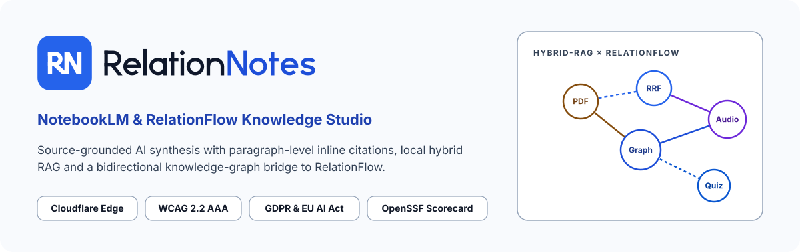
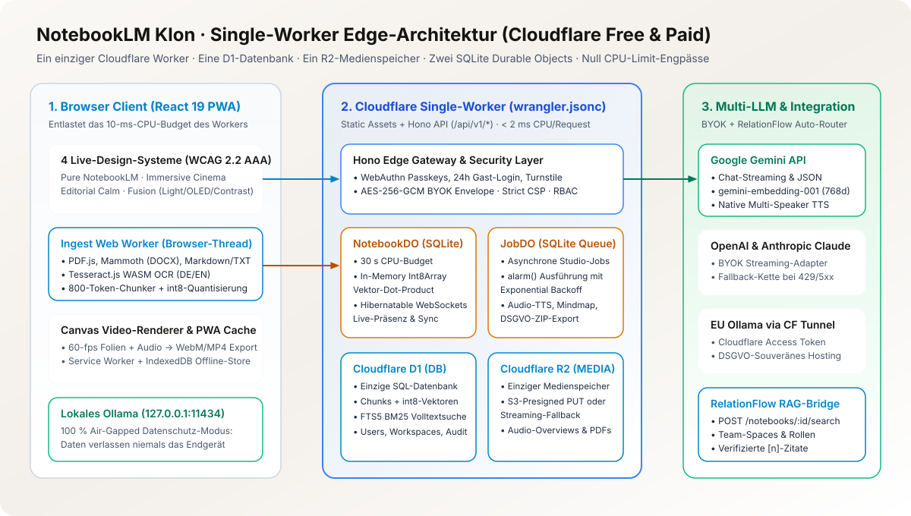
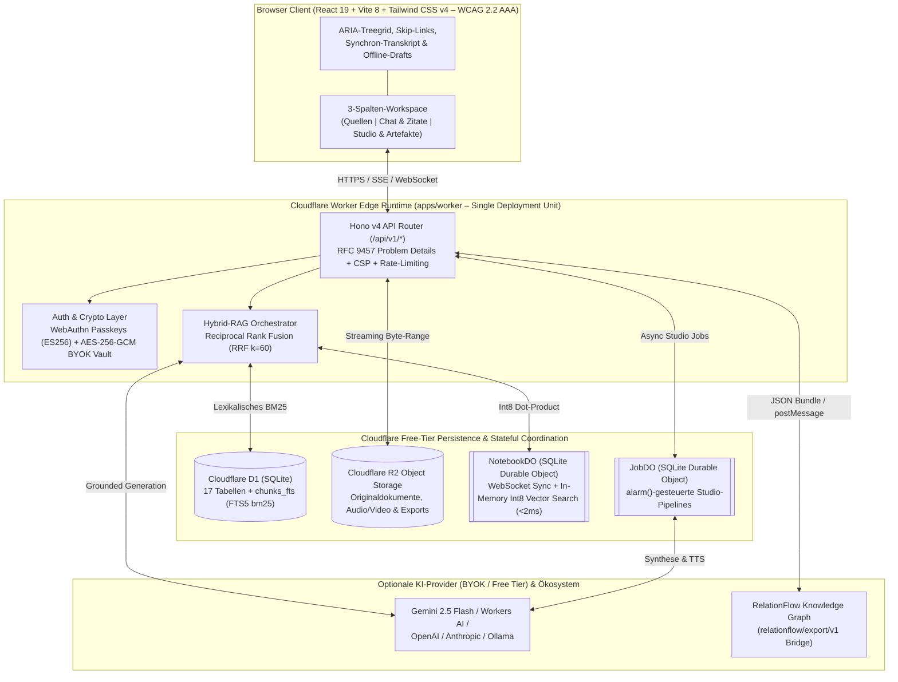
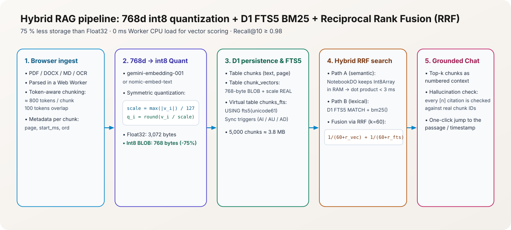
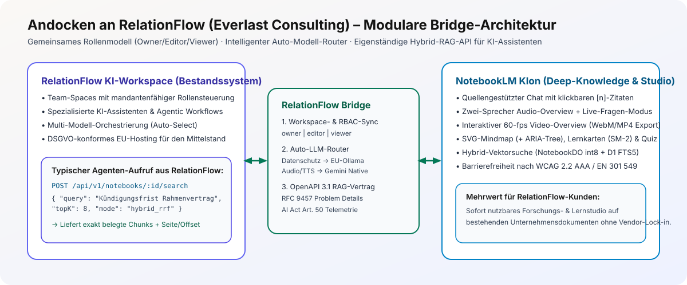
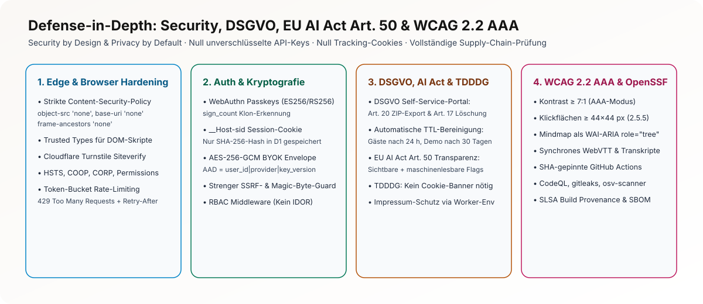

<div align="center">

<picture>
  <source media="(prefers-color-scheme: dark)" srcset="docs/assets/hero-banner-dark.svg">
  <source media="(prefers-color-scheme: light)" srcset="docs/assets/hero-banner-light.svg">
  
</picture>
<sub>Grafik in <a href="docs/assets/hero-banner-de.svg" hreflang="de" lang="de">Deutsch</a> · <a href="docs/assets/hero-banner-en.svg" hreflang="en" lang="en">English</a></sub>

# RelationNotes

### **NotebookLM & RelationFlow Knowledge Studio**

*Quellengebundene KI-Forschung, Hybrid-RAG (D1 FTS5 + Int8-Vektorsuche), multimodales Audio-/Video-Studio und bidirektionale Wissensgraph-Synthese – zu 100 % lauffähig im kostenlosen Cloudflare Free Tier.*

[](https://github.com/VectoDE/Notebook-LM-Klon/actions/workflows/ci.yml)
[](https://github.com/VectoDE/Notebook-LM-Klon/actions/workflows/codeql.yml)
[](https://scorecard.dev/viewer/?uri=github.com/VectoDE/Notebook-LM-Klon)
[](vitest.config.ts)
[](docs/accessibility-wcag-aaa.md)
[](LICENSE)

[**Offizielles GitHub Wiki**](https://github.com/VectoDE/Notebook-LM-Klon/wiki) · [**Systemarchitektur**](docs/architecture.md) · [**Hybrid-RAG & Vektoren**](docs/rag-and-vectors.md) · [**RelationFlow-Brücke**](docs/relationflow-integration.md) · [**Security & DSGVO**](docs/security-and-compliance.md) · [**WCAG 2.2 AAA**](docs/accessibility-wcag-aaa.md)

</div>

---

## Schnell-Einstieg nach Lesergruppe (Navigation für Reviewer)

| Zielgruppe | Was Sie hier in 2 Minuten finden | Direkte Einstiegspunkte |
| :--- | :--- | :--- |
| **HR, Recruiting & Produkt-Entscheider** | Ein schlüsselfertiges KI-Forschungs- & Wissens-Studio, das Dokumente mit **absatzgenauen Inline-Zitaten `[1]`** belegt, als **Zwei-Host-Podcast** vertont und nahtlos mit dem Wissensgraphen [**RelationFlow**](https://github.com/VectoDE/RelationFlow) verbindet – ohne laufende Cloud-Fixkosten (`0 €` Cloudflare Free Tier). | [Kernfunktionen](#warum-relationnotes--kernfunktionen--alleinstellungsmerkmale) · [Loom-Präsentations-Leitfaden](docs/loom-presentation-guide.md) · [Barrierefreiheit WCAG 2.2 AAA](docs/accessibility-wcag-aaa.md) |
| **Senior Engineers & Tech Leads** | Strikte Edge-Architektur unter realen **10 ms CPU-Limits** pro Request: **Reciprocal Rank Fusion (`k = 60`)** aus SQLite `FTS5` (`bm25`) und `int8`-quantisierten Matryoshka-Vektoren (`768 Dim`) im `NotebookDO`-RAM (`< 2 ms`), `node:sqlite`-Verifikation, **100 % Testabdeckung** (Unit, Integration, Contract, `fast-check` Property-Fuzzing). | [Systemarchitektur](docs/architecture.md) · [Hybrid-RAG-Mathematik](docs/rag-and-vectors.md) · [Cloudflare-Budgets](docs/platform-limits.md) · [D1-Datenbankschema](docs/database-schema.md) |
| **Security-, Privacy- & OpenSSF-Auditoren** | **WebAuthn Passkeys (`ES256`)**, Envelope-Encryption (**AES-256-GCM mit AAD**) für BYOK-API-Schlüssel, strikter SSRF-Guard, SHA-gepinnte GitHub Actions, `gitleaks`, `osv-scanner`, `CodeQL`, OpenSSF Scorecard sowie vollständige **DSGVO- & EU-AI-Act-Art.-50-Konformität** (C2PA / SynthID / JSON-Manifeste). | [Security, DSGVO & AI Act](docs/security-and-compliance.md) · [OpenSSF-Richtlinie](docs/openssf.md) · [`.github/SECURITY.md`](.github/SECURITY.md) |

---

## Warum RelationNotes? – Kernfunktionen & Alleinstellungsmerkmale

Klassische KI-Chats halluzinieren Zusammenhänge und verlieren nach dem Gespräch den Bezug zu den Originaldokumenten. **RelationNotes** verbindet die präzise Quellentreue von **Google NotebookLM** mit der strukturierten Wissensmodellierung von [**RelationFlow**](https://github.com/VectoDE/RelationFlow):

1. **Multi-Format-Quellen-Ingestion & Zitat-Präzision:**
   - Verarbeitung von **PDFs** (`unpdf`), **DOCX** (`mammoth`), **Markdown/TXT/CSV**, **Webseiten** (Readability + strikter SSRF-Guard), **YouTube-Transkripten** und **Audio-Aufnahmen**.
   - Jede KI-Aussage enthält klickbare **Inline-Zitate (`[1]`, `[2]`)**, die im Quellen-Viewer exakt den belegenden Originalabsatz samt Zeichen-Offset (`start_offset`, `end_offset`) und Textmarkierung hervorheben.
2. **Lokale Hybrid-RAG-Engine ohne externe Vektordatenbank-Kosten:**
   - **Lexikalische Suche:** SQLite `FTS5` mit `unicode61`-Tokenizer und `bm25()`-Ranking direkt in Cloudflare D1.
   - **Semantische Vektorsuche:** Matryoshka-Embeddings (`768 Dimensionen`), `int8`-skalar-quantisiert (`768 Byte/Chunk` als `BLOB` in D1) und im Arbeitsspeicher des zuständigen `NotebookDO` in **`< 2 ms`** per Dot-Product ausgewertet.
   - **Reciprocal Rank Fusion (`RRF, k = 60`):** Deterministische Verschmelzung beider Rankings ohne kostenpflichtige Drittanbieter-Vektor-Cloud.
3. **Multimodales Studio (Audio-Overview, Video-Slides, Mindmap, Lernkarten, Quiz):**
   - **Zwei-Host-Audio-Overview:** Generiert natürliche Dialog-Skripte zwischen *Host A* (analytisch) und *Host B* (synthetisierend), synthetisiert diese zu einer abspielbaren Episode in Cloudflare R2 und liefert ein **wortgenaues, barrierefreies Synchron-Transkript**.
   - **Interaktive Mindmap & Lernwerkzeuge:** Automatische Konzeptgraphen (`@xyflow/react` + parallele ARIA-Treegrid-Gliederung), Spaced-Repetition-Lernkarten (`SM-2`) und Multiple-Choice-Quizzes mit Zitat-Begründung.
4. **Andock-Konzept für RelationFlow:**
   - Heute umgesetzt: die eigenständige Such-API `POST /api/v1/notebooks/:id/search` (Agenten können Notebook-Wissen als Tool abfragen), die Rollen `owner`, `editor` und `viewer` sowie der Auto-Modell-Router mit Datenschutzmodus.
   - Noch nicht umgesetzt: der Austausch von Entitäten und Kanten als `relationflow/export/v1`-Bundle. Das Format ist beschrieben, im Code gibt es dafür noch keine Implementierung. Details im Kapitel [Andocken an RelationFlow](#andocken-an-relationflow).
5. **Zwei Betriebsprofile (`APP_PROFILE=demo` vs. `full`) & BYOK:**
   - **Öffentlicher Demo-Showcase (`demo`):** Sofortiger 1-Klick-Gastzugang mit 2 kuratierten deutschen Beispiel-Notebooks (*„EU AI Act & DSGVO in der Praxis“* und *„Cloudflare Edge-Architektur & Hybrid-RAG“*), vorab berechneten Studio-Artefakten und Bring-Your-Own-Key (BYOK).
   - **Vollbetrieb (`full`):** Selbst-gehosteter Produktivmodus für Teams mit großzügigen Kontingenten (`100 Notebooks`, `50 Quellen`, `50.000 Chunks`).

---

## Systemarchitektur auf einen Blick

<picture>
  <source media="(prefers-color-scheme: dark)" srcset="docs/assets/architecture-overview-dark.svg">
  <source media="(prefers-color-scheme: light)" srcset="docs/assets/architecture-overview-light.svg">
  
</picture>
<sub>Grafik in <a href="docs/assets/architecture-overview-de.svg" hreflang="de" lang="de">Deutsch</a> · <a href="docs/assets/architecture-overview-en.svg" hreflang="en" lang="en">English</a></sub>



---

## Hybrid-RAG-Pipeline & RelationFlow-Wissensgraph-Brücke

| Hybrid-RAG-Pipeline (`FTS5` + `Int8` + `RRF k=60`) | Bidirektionale RelationFlow-Brücke (`v1`) |
| :---: | :---: |
| <picture><source media="(prefers-color-scheme: dark)" srcset="docs/assets/rag-pipeline-dark.svg"><source media="(prefers-color-scheme: light)" srcset="docs/assets/rag-pipeline-light.svg"></picture><br><sub>Grafik in <a href="docs/assets/rag-pipeline-de.svg" hreflang="de" lang="de">Deutsch</a> · <a href="docs/assets/rag-pipeline-en.svg" hreflang="en" lang="en">English</a></sub> | <picture><source media="(prefers-color-scheme: dark)" srcset="docs/assets/relationflow-bridge-dark.svg"><source media="(prefers-color-scheme: light)" srcset="docs/assets/relationflow-bridge-light.svg"></picture><br><sub>Grafik in <a href="docs/assets/relationflow-bridge-de.svg" hreflang="de" lang="de">Deutsch</a> · <a href="docs/assets/relationflow-bridge-en.svg" hreflang="en" lang="en">English</a></sub> |
| Details in [`docs/rag-and-vectors.md`](docs/rag-and-vectors.md) | Details in [`docs/relationflow-integration.md`](docs/relationflow-integration.md) |

---

## Die vier Designs

Die Oberfläche lässt sich im laufenden Betrieb zwischen vier eigenständigen Designs umschalten. Jedes hat eigene Farben, eine eigene Schrift und eine eigene Anmutung. Dazu kommen die Farbmodi Hell, Dunkel und AAA-Hochkontrast. Die Token stehen in [`apps/web/src/design-tokens.ts`](apps/web/src/design-tokens.ts).

| Design | Idee | Schrift |
| :--- | :--- | :--- |
| **Pure NotebookLM** | Ruhige, helle Arbeitsfläche mit weichen Panels, Anmutung wie NotebookLM, eigene Farbe in Indigo und Lavendel. Standard. | Inter |
| **Immersive Cinema** | Nacht-Violett mit Fuchsia- und Cyan-Licht, eigene Bewegungssprache (abgeschaltet bei `prefers-reduced-motion`). | Space Grotesk |
| **Editorial Calm** | Farbwelt von Everlast und RelationFlow: Everlast-Blau für Flächen, Slate-Neutraltöne. | Source Serif 4 |
| **Fusion** | Petrol und Teal mit Bernstein, eigenständige Palette. | Geist |

---

## Die sechs Studio-Werkzeuge

Das Studio-Panel bietet sechs Werkzeuge. Sie arbeiten mit den Quellen des Notebooks und zeigen ihre Belege an.

| Werkzeug | Was es tut |
| :--- | :--- |
| **Audio-Overview** | Zwei-Host-Gespräch mit mitlaufendem Transkript. Per Rückfrage (`POST /api/v1/notebooks/:id/audio-interject`) lässt sich mitten im Gespräch nachfragen. |
| **Video-Overview** | Folien mit Kapiteln, im Browser abspielbar, Export als `.webm`. |
| **Mindmap** | Konzeptgraph als SVG, zusätzlich als ARIA-Baumansicht, mit Export. |
| **Lernkarten** | Karten zum Umdrehen, mit Export. |
| **Quiz** | Fragen mit Begründung aus der Quelle, mit Export. |
| **Briefing** | Kurzfassung des Notebooks. |

---

## Andocken an RelationFlow

[RelationFlow](https://github.com/VectoDE/RelationFlow) ist der Wissens-Workspace, an den RelationNotes sich anschließen soll. Die Beschreibung steht in [`docs/relationflow-integration.md`](docs/relationflow-integration.md). Hier der ehrliche Stand:

| Baustein | Stand | Wo |
| :--- | :--- | :--- |
| Such-API für Agenten: Hybrid-Suche (Vektor und FTS5, RRF) mit Zitaten, Seite und Offsets | Umgesetzt | `POST /api/v1/notebooks/:id/search`, siehe [`docs/openapi.json`](docs/openapi.json) |
| Rollen `owner`, `editor`, `viewer` je Notebook | Umgesetzt | `apps/worker/src/auth-middleware.ts` |
| Auto-Modell-Router, im Datenschutzmodus lokal (Ollama) | Umgesetzt | `GET /api/v1/providers`, `POST /api/v1/providers/route` |
| Studio-Jobs per API einreihen | Teilweise | `POST /api/v1/jobs/enqueue`. Status und Abbruch einzelner Jobs sind noch gesperrt, bis die Besitzprüfung steht. |
| Austausch von Entitäten und Kanten (`relationflow/export/v1`) | Noch nicht umgesetzt | Format nur beschrieben |

**Beispiel:** Ein Agent fragt ein Notebook ab. Er braucht eine Sitzung (Cookie) und mindestens die Rolle `viewer`.

```bash
curl -s -X POST "http://localhost:8787/api/v1/notebooks/<notebook-id>/search"   -H "content-type: application/json"   -b "sid=<sitzungs-token>"   -d '{"query":"Was verlangt Artikel 50 des EU AI Act?","mode":"hybrid","limit":5}'
```

Die Antwort enthält `results` mit `sourceTitle`, `page`, `score` und `snippet` je Fundstelle. Eine Anbindung von RelationFlow-Agenten braucht noch einen Weg, eine Sitzung für den Agenten zu erzeugen. Der steht nicht in dieser Version.

---

## API-Referenz (OpenAPI 3.1)

Alle Endpunkte unter `/api/v1` sind in [`docs/openapi.json`](docs/openapi.json) beschrieben, Fehler nach RFC 9457. Ein Test (`packages/shared/src/__tests__/openapi.test.ts`) liest die Routen aus dem Worker-Code und schlägt fehl, wenn eine Route in der Spezifikation fehlt. Neue Routen gehören also immer in diese Datei.

---

## Ehrlicher KI-Einsatz

- **Bei der Entwicklung:** Dieses Projekt entsteht mit KI-Coding-Assistenten. Der Inhaber legt Anforderungen, Architektur und Abnahme fest und prüft die Ergebnisse. Jede Änderung muss durch Typprüfung, Linter, Tests mit 100 % Abdeckung und Sicherheits-Scans, bevor sie in `main` kommt. Commits und Pull Requests tragen keine KI-Kennzeichnung (Entscheidung #38). Die Offenlegung steht deshalb hier.
- **Im Produkt:** Antworten, Audio, Video und Studio-Artefakte kommen von einem Sprachmodell und sind als KI-generiert markiert (`aiGenerated: true`, Anbieter, Modell, Zeitstempel). Welches Modell antwortet, bestimmt der Nutzer oder der Auto-Router. Mit Datenschutzmodus bleibt die Anfrage bei einem lokalen Modell. Bei Cloud-Modellen gehen Frage und Textausschnitte an den gewählten Anbieter. API-Schlüssel gehören dem Nutzer (BYOK) und liegen verschlüsselt (AES-256-GCM).
- **Grenzen:** Zitate verweisen auf Textstellen, die das Modell gelesen hat. Ob das Modell sie richtig deutet, bleibt zu prüfen.

---

## Technologie-Stack & Architekturentscheidungen

| Schicht | Eingesetzte Technologie | Version | Begründung & Mehrwert im Projekt |
| :--- | :--- | :--- | :--- |
| **Monorepo & Paketmanager** | `pnpm` Workspaces | `11.x` | Strikte Paket-Isolation (`packages/shared`, `apps/worker`, `apps/web`), deterministisches Lockfile. |
| **Sprache & Typisierung** | TypeScript (`strict: true`) | `5.8.x` | `noUncheckedIndexedAccess`, `exactOptionalPropertyTypes` und generierte Cloudflare-Bindings (`wrangler types`). |
| **Edge-Backend & API** | Cloudflare Workers + `Hono` | `4.13.x` | Minimale Cold-Start-Latenz (`0 ms`), native Web-Standards (`Request`/`Response`), RFC-9457-Fehlerbehandlung. |
| **Datenbank & Volltext** | Cloudflare D1 (`SQLite` + `FTS5`) | Edge Native | Relationale Integrität über 17 Tabellen plus nativer `FTS5`-Index (`unicode61`, `bm25()`) ohne Zusatzkosten. |
| **Echtzeit & Hintergrund-Jobs** | Cloudflare SQLite Durable Objects | `NotebookDO`, `JobDO` | Zustandsbehaftete In-Memory-Vektorsuche (`< 2 ms`), WebSocket-Kollaboration und `alarm()`-basierte Studio-Jobs. |
| **Objektspeicher** | Cloudflare R2 | S3-kompatibel | Kostenfreie Egress-Auslieferung für PDF-Quellen, Audio-Overviews und DSGVO-Datenexporte (`10 GB Free Tier`). |
| **Frontend-Workspace** | React 19 + Vite 8 | `19.3.x` / `8.3.x` | Schnelle Drei-Spalten-Oberfläche mit barrierefreier Semantik und lokalem Entwurfsschutz. |
| **Verträge & Validierung** | `Zod` | `4.6.x` | Gemeinsame Laufzeit-Schemata zwischen Worker und Frontend inkl. RFC 9457 Problem Details. |
| **Linter & A11y-Statik** | `@biomejs/biome` | `1.9.x` | Einheitliches Linting & Formatting mit **29 verschärften WAI-ARIA-/JSX-Barrierefreiheitsregeln**. |
| **Test- & Fuzzing-Suite** | `Vitest` + `@vitest/coverage-v8` + `fast-check` | `5.1.x` / `4.10.x` | **100 % Code-Coverage-Gate** (Lines, Functions, Branches, Statements) + Property-Based Fuzzing. |
| **AppSec & Supply Chain** | `Gitleaks`, `OSV-Scanner`, `CodeQL`, `Scorecard` | SHA-gepinnt | Lückenlose Prüfung auf Secrets, CVEs, SAST-Schwachstellen und OpenSSF-Best-Practices bei jedem Push/PR. |

---

## Sicherheit, Barrierefreiheit & DSGVO

<picture>
  <source media="(prefers-color-scheme: dark)" srcset="docs/assets/security-layers-dark.svg">
  <source media="(prefers-color-scheme: light)" srcset="docs/assets/security-layers-light.svg">
  
</picture>
<sub>Grafik in <a href="docs/assets/security-layers-de.svg" hreflang="de" lang="de">Deutsch</a> · <a href="docs/assets/security-layers-en.svg" hreflang="en" lang="en">English</a></sub>

- **Kryptografisches Budget innerhalb von 10 ms CPU-Zeit:** Durch unseren Benchmark ([`apps/worker/src/crypto-benchmark.ts`](apps/worker/src/crypto-benchmark.ts)) ist nachgewiesen, dass `SHA-256` (`~0,01 ms`), `AES-256-GCM` Envelope-Roundtrip mit `AAD` (`~0,03 ms`) und `ECDSA P-256` Passkey-Verifikation (`~0,25 ms`) zusammen **`< 0,6 ms` CPU-Zeit** benötigen – über **94 % der 10-ms-Free-Tier-Reserve** bleiben frei für Fachlogik.
- **Barrierefreiheit:** Jede der vier Oberflächen gibt es in Hell, Dunkel und AAA-Hochkontrast. Das Ziel für Text ist ein Kontrast von mindestens 7:1 (WCAG 2.2, 1.4.6), für Rahmen und Fokus mindestens 3:1. Die Vorgaben stehen in `apps/web/src/design-tokens.ts`, der Stand der Prüfung in [`docs/accessibility-wcag-aaa.md`](docs/accessibility-wcag-aaa.md).
- **DSGVO-Rechte per 1-Klick:** Vollständiger maschinenlesbarer Datenexport (Art. 15 / Art. 20 DSGVO) sowie kryptografisch verifizierte Kaskadenlöschung über D1, R2 und Durable Objects (Art. 17 DSGVO).
- **EU AI Act Art. 50 Transparenz:** Jedes generierte Audio-, Video-, Text- oder Graph-Artefakt trägt ein sichtbares KI-Kennzeichen sowie ein maschinenlesbares Provenienz-Manifest (`ai_generated: true`, Modell-ID, Zeitstempel, SHA-256-Quell-Hashes).

---

## Schnellstart – Einrichtung, Tests & Verifikation

### Voraussetzungen
- **Node.js** `>= 22.0.0`
- **pnpm** `>= 10.0.0` (oder Corepack aktiviert)

### 1. Repository klonen & Abhängigkeiten installieren
```bash
git clone https://github.com/VectoDE/Notebook-LM-Klon.git
cd Notebook-LM-Klon
pnpm install --frozen-lockfile
```

### 2. Qualitäts-, Sicherheits- & 100-%-Coverage-Gates ausführen
```bash
# 1. Biome Linter, Formatierer & 29 WAI-ARIA A11y-Regeln prüfen
pnpm lint

# 2. Strikte TypeScript-Typprüfung über alle Workspaces
pnpm typecheck

# 3. Vollständige Test-Suite (Unit, Integration, Contract, Property-Fuzzing, A11y) mit 100 % Coverage-Gate
pnpm test:coverage

# 4. Produktions-Build (Shared -> Worker & React Web-App)
pnpm build
```

### 3. Lokale Edge-Entwicklung starten
```bash
# Startet den lokalen Cloudflare Worker (Port 8787) bzw. die Web-App (Port 5173)
pnpm --filter @notebook-lm/worker dev
pnpm --filter @notebook-lm/web dev
```

Prüfe den lokalen Health-Endpunkt:
```bash
curl -i http://localhost:8787/api/v1/health
```

### 4. Betrieb: Client-IP und `TRUSTED_PROXY_HEADER` (für Betreiber)

Rate-Limits, Turnstile (`remoteip`), Sitzungen und das BYOK-Audit-Log brauchen die IP-Adresse des Clients. Der Worker ermittelt sie an genau einer Stelle, `resolveClientIp()` in [`apps/worker/src/rate-limiter.ts`](apps/worker/src/rate-limiter.ts), und vertraut dabei nur Quellen, die nicht vom Client stammen:

| Reihenfolge | Quelle | Wann sie gilt |
| :--- | :--- | :--- |
| 1 | Header aus `TRUSTED_PROXY_HEADER`, davon der **letzte** Eintrag | Nur wenn der Betreiber die Variable setzt |
| 2 | `cf-connecting-ip` | Nur in der Cloudflare-Workers-Laufzeit (setzt die Cloudflare-Edge) |
| 3 | Socket-Adresse der TCP-Verbindung | Nur im Node-Server |

Ohne diese Garantien werden `cf-connecting-ip` und `x-forwarded-for` ignoriert, weil jeder Client sie frei setzen kann. Ist keine vertrauenswürdige IP bekannt, wird keine IP gespeichert oder an Turnstile übergeben.

- **Cloudflare Workers:** nichts einstellen. Die Edge setzt `cf-connecting-ip` selbst.
- **Node-Server direkt im Internet:** nichts einstellen. Es zählt die Socket-Adresse.
- **Node-Server hinter einem Reverse Proxy** (nginx, Caddy, Traefik, Load Balancer): `TRUSTED_PROXY_HEADER` auf den Header setzen, den **Ihr** Proxy schreibt, zum Beispiel `TRUSTED_PROXY_HEADER=x-forwarded-for` oder `TRUSTED_PROXY_HEADER=x-real-ip`. Groß- und Kleinschreibung spielen keine Rolle.

Wichtig: Setzen Sie `TRUSTED_PROXY_HEADER` nur, wenn der Server ausschließlich über diesen Proxy erreichbar ist und der Proxy den Header selbst anhängt oder überschreibt (nginx: `proxy_set_header X-Forwarded-For $proxy_add_x_forwarded_for;` oder `proxy_set_header X-Real-IP $remote_addr;`). Ist der Server zusätzlich direkt erreichbar, kann ein Angreifer den Header fälschen und Rate-Limits umgehen. Bei mehreren Proxys hintereinander zählt der letzte Eintrag, also die Adresse, die der Proxy direkt vor dem Server gesehen hat.

---

## Saubere Repository-Struktur (Entscheidung #108)

Alle Community-, Sicherheits- und Automatisierungs-Konfigurationen sind im Ordner [`.github/`](.github/) gebündelt, sodass das Hauptverzeichnis übersichtlich auf die technisch notwendigen Projektdateien fokussiert bleibt:

```text
Notebook-LM-Klon/
├── .github/                        # Governance, Security, CI/CD & Templates
│   ├── workflows/                  # SHA-gepinnte Workflows (ci, codeql, scorecard, deploy, release, verify-issue-checklists, wiki-sync)
│   ├── ISSUE_TEMPLATE/             # Strukturierte Formulare (Bug, Feature, Security, Config)
│   ├── CITATION.cff                # Wissenschaftliche Zitier-Metadaten
│   ├── CODE_OF_CONDUCT.md          # Contributor Covenant v2.1
│   ├── CODEOWNERS                  # Verbindliche Code-Verantwortlichkeiten (@VectoDE)
│   ├── CONTRIBUTING.md             # 1 Issue = 1 Branch = 1 PR, 100 % TDD & Qualitätsregeln
│   ├── FUNDING.yml                 # Sponsoring-Metadaten
│   ├── PULL_REQUEST_TEMPLATE.md    # Verbindliche Abnahme-Checkliste
│   ├── SECURITY.md                 # Coordinated Vulnerability Disclosure & Kryptografie-Architektur
│   ├── SUPPORT.md                  # Support- & Diskussionskanäle
│   ├── dependabot.yml              # Wöchentliche Abhängigkeits-Checks
│   ├── gitleaks.toml               # Secret-Scanner-Konfiguration
│   ├── release.yml                 # Kategorisierte Release-Notes-Generierung
│   └── renovate.json               # Automatisches SHA-Digest-Pinning
├── apps/
│   ├── web/                        # React 19 + Vite 8 Frontend (Warm Editorial Research Studio, WCAG 2.2 AAA)
│   └── worker/                     # Cloudflare Worker (Hono API, D1 FTS5, R2, NotebookDO & JobDO)
├── packages/
│   └── shared/                     # Geteilte Zod-Schemata, RFC 9457 Problem Details, UTF-8/Encoding-Prüfer
├── docs/                           # 9 Fachkapitel + 5 SVG-Architekturdiagramme + GitHub-Wiki-Quellen
│   ├── assets/                     # Diagramme und Hero je Deutsch (-de), Englisch (-en) und automatisch (systemLanguage); Quellen in src/, Texte in i18n/strings.json
│   └── wiki/                       # 1:1 synchronisierte GitHub-Wiki-Seiten (Home, _Sidebar, _Footer, Kapitel 1–8)
├── biome.json                      # Linter, Formatter & 29 WAI-ARIA A11y-Regeln
├── CHANGELOG.md                    # Versionshistorie nach Keep a Changelog
├── LICENSE                         # MIT License
├── package.json                    # Monorepo-Skripte & Root-Konfiguration
├── pnpm-workspace.yaml             # Workspace-Definition (packages/*, apps/*)
├── tsconfig.base.json              # Strikte TypeScript-Basis-Konfiguration
└── vitest.config.ts                # Test-Runner mit 100 % Coverage-Schwellenwerten
```

---

## Vollständiges Projekthandbuch & GitHub Wiki

Sämtliche Architekturentscheidungen (ADRs #1–#110) sind im Ordner [`docs/`](docs/) sowie im [offiziellen GitHub Wiki](https://github.com/VectoDE/Notebook-LM-Klon/wiki) dokumentiert:

1. [**Systemarchitektur & Edge-Runtime**](docs/architecture.md) – Single-Worker-Topologie, `NotebookDO` vs. `JobDO`, `demo`- vs. `full`-Profile.
2. [**Hybrid-RAG & Int8-Vektorsuche**](docs/rag-and-vectors.md) – SQLite `FTS5` (`bm25`), Matryoshka `int8`-Quantisierung und Reciprocal Rank Fusion (`k = 60`).
3. [**RelationFlow-Wissensgraph-Integration**](docs/relationflow-integration.md) – Kanonisches Austauschformat `relationflow/export/v1` und bidirektionale Synchronisation.
4. [**Datenbank-Schema (Cloudflare D1)**](docs/database-schema.md) – Alle 17 Tabellen, Trigger, Indizes und kaskadierende Löschpfade.
5. [**Security, DSGVO & EU AI Act**](docs/security-and-compliance.md) – WebAuthn Passkeys, AES-256-GCM BYOK, SSRF-Guard und Artikel-50-Provenienz.
6. [**Barrierefreiheit nach WCAG 2.2 Level AAA**](docs/accessibility-wcag-aaa.md) – Farbkontraste (`>= 7:1`), Fokus-Ringe, Tastatursteuerung und multimodale Alternativen.
7. [**Cloudflare Free-Tier-Limits & CPU-Budgets**](docs/platform-limits.md) – Empirische Benchmarks (`< 0,6 ms` WebCrypto) und Kapazitätsrechnung.
8. [**Loom-Präsentations- & Bewerbungs-Leitfaden**](docs/loom-presentation-guide.md) – Drehbuch für eine überzeugende 10-Minuten-Vorführung.
9. [**Anforderungs- & Entscheidungsregister (ADRs #1–#110)**](docs/anforderungen.md) – Lückenlose Dokumentation aller 110 Architektur- und Qualitätsentscheidungen.
10. [**Lasttests (k6, lokal und Live-Rauchtest)**](docs/load-test.md) – 200 gleichzeitige simulierte Nutzer mit Upload, Chat, Suche und Studio, p95 249 ms, 0 % Fehler; [HTML-Report](docs/load-test/report-local.html) und [JSON](docs/load-test/summary-local.json).

---

## Mitwirken, Engineering-Methodik & Lizenz

- **Engineering-Methodik & Transparenz:** Dieses Projekt wird nach strengem Software-Engineering-Maßstab entwickelt: Spezifikationsgetriebene Architektur (110 dokumentierte ADRs), striktes `1 Issue = 1 Branch = 1 PR`-Vorgehen mit Echtzeit-Checklisten-Verifikation, **100 % automatisierte Testabdeckung** (Unit, Integration, Contract, Property-Based Fuzzing, Security, A11y) sowie **OpenSSF-Härtung**. Moderne KI-Entwicklungswerkzeuge werden als Produktivitätsmultiplikator unter menschlicher Architekturhoheit eingesetzt; jede Zeile Code durchläuft deterministische Typ-, Linter-, Security- und Test-Gates.
- **Beitragsrichtlinien:** Siehe [`.github/CONTRIBUTING.md`](.github/CONTRIBUTING.md) und [`.github/CODE_OF_CONDUCT.md`](.github/CODE_OF_CONDUCT.md).
- **Sicherheitsmeldungen:** Bitte nutze für Schwachstellenmeldungen ausschließlich unser [Private Vulnerability Reporting](https://github.com/VectoDE/Notebook-LM-Klon/security/advisories/new) gemäß [`.github/SECURITY.md`](.github/SECURITY.md).
- **Lizenz:** Veröffentlicht unter der [MIT-Lizenz](LICENSE). Copyright (c) 2026 Tim Hauke.
- **Schriften (SIL Open Font License 1.1):** Die Web-App liefert alle Schriften selbst gehostet aus (kein externes CDN), je Design eine eigene: Pure Inter, Editorial Calm Source Serif 4, Immersive Cinema Space Grotesk, Fusion Geist, dazu JetBrains Mono für Zeitstempel. Lizenztexte: [Inter](apps/web/public/fonts/LICENSES/Inter-OFL.txt), [Source Serif 4](apps/web/public/fonts/LICENSES/SourceSerif4-OFL.txt), [Space Grotesk](apps/web/public/fonts/LICENSES/SpaceGrotesk-OFL.txt), [Geist](apps/web/public/fonts/LICENSES/Geist-OFL.txt), [JetBrains Mono](apps/web/public/fonts/LICENSES/JetBrainsMono-OFL.txt). Im Build liegen sie unter `/fonts/LICENSES/`. Die Dateien selbst (WOFF2, Latin-Subset für Deutsch und Englisch, variabel über die Strichstärke, zusammen rund 190 KB; der Browser lädt nur, was das aktive Design anzeigt, im Standard-Design Pure Inter und JetBrains Mono mit 87 KB) liegen mit Herkunft und SHA-256-Prüfsummen in [`apps/web/src/fonts/`](apps/web/src/fonts/SOURCES.txt).
