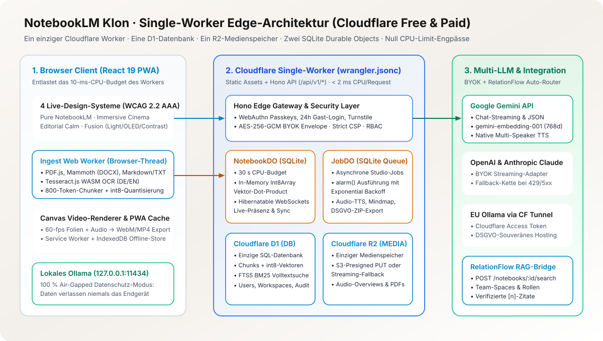
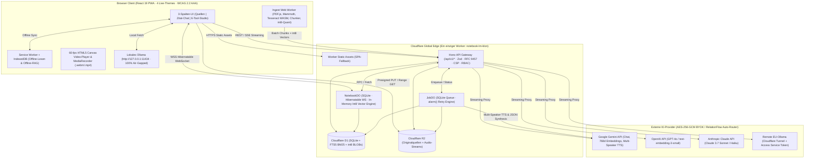
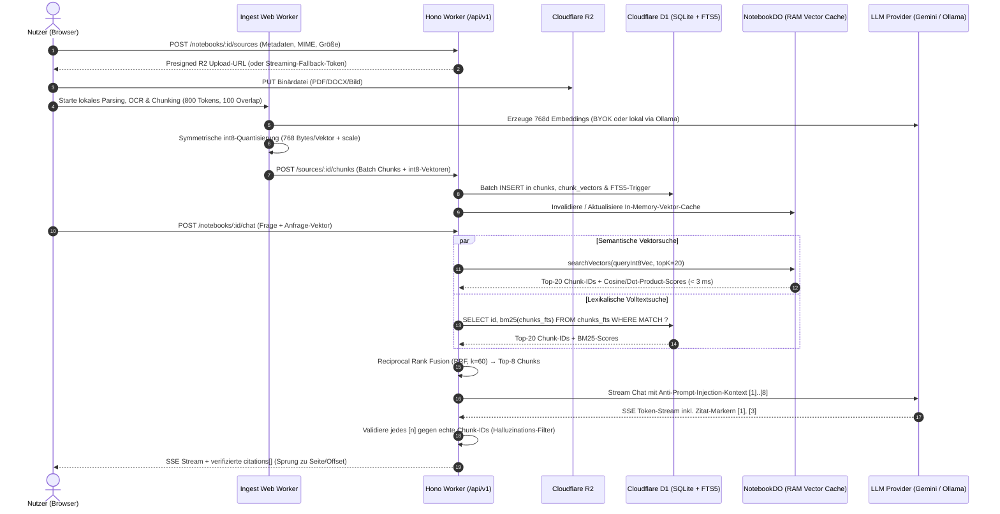

# Systemarchitektur: Single-Worker Edge-Design

Stand: 2026-11-09 · Referenzen: Entscheidungen #4, #7, #11, #17, #18, #21, #22, #50

<picture>
  <source media="(prefers-color-scheme: dark)" srcset="./assets/architecture-overview-dark.svg">
  <source media="(prefers-color-scheme: light)" srcset="./assets/architecture-overview-light.svg">
  
</picture>
Grafik in <a href="./assets/architecture-overview-de.svg" hreflang="de" lang="de">Deutsch</a> · <a href="./assets/architecture-overview-en.svg" hreflang="en" lang="en">English</a>

## 1. Leitprinzipien der Architektur

Der NotebookLM-Klon wurde von Grund auf für maximale Performance, strikte Datensouveränität und minimale Betriebskosten entworfen:

1. **Ein einziger Cloudflare Worker (`apps/worker`):** Liefert sowohl die statischen React-19-PWA-Assets (`ASSETS`-Binding mit SPA-Fallback) als auch die gesamte REST-/SSE-/WebSocket-API unter `/api/v1/*` (Hono-Framework) aus.
2. **Eine einzige SQL-Datenbank (`DB` – Cloudflare D1):** Speichert Nutzer, Passkeys, Sessions, Workspaces, Notebooks, Quell-Metadaten, Text-Chunks, `int8`-quantisierte 768d-Vektoren, den `FTS5`-Volltextindex sowie Chat-Verläufe und Audit-Logs.
3. **Ein einziger Medienspeicher (`MEDIA` – Cloudflare R2):** Hält hochgeladene Originaldokumente (PDF, Audio, Bilder) sowie synthetisierte Multi-Speaker-Audio-Overviews und DSGVO-Datenexport-Archive.
4. **Zwei SQLite-Durable-Objects (`NotebookDO` & `JobDO`):**
   - `NotebookDO`: Verwaltet pro Notebook die Echtzeit-Kollaboration (Hibernatable WebSockets, Live-Präsenz, LWW-Notizen) und hält die `int8`-Vektoren des Notebooks im Arbeitsspeicher für Millisekunden-schnelles Dot-Product-Scoring (30 s CPU-Budget statt 10 ms Worker-Limit).
   - `JobDO`: Verarbeitet Hintergrundjobs (Audio-Overview-TTS, Video-Storyboard, Mindmap, Flashcards, Quiz, DSGVO-Export) zuverlässig über eine SQLite-Queue und `alarm()` mit exponentiellem Backoff.
5. **Browser-Ingest-Pipeline (Web Worker):** PDF-Textextraktion (`pdf.js`), DOCX-Konvertierung (`mammoth`), Bild-OCR (`Tesseract.js` WASM) und das token-bewusste Chunking laufen im Browser des Nutzers. Dadurch kostet der Dokumenten-Ingest im Cloudflare Worker nahezu null CPU-Millisekunden.

---

## 2. Datenfluss-Diagramm (Komponenten & Protokolle)

---

## 3. Sequenzdiagramm: Dokumenten-Upload, Hybrid-RAG & Zitat-Chat

---

## 4. Monorepo-Struktur (`pnpm-workspace.yaml`)

| Paket | Pfad | Verantwortung |
|---|---|---|
| `@notebook-lm/shared` | `packages/shared` | Gemeinsame Zod-Schemas, RFC 9457 Problem Details, DTOs, `int8`-Quantisierungs-Mathematik, RRF-Algorithmus, Zitat-Validator und UTF-8-Encoding-Guard. |
| `@notebook-lm/worker` | `apps/worker` | Cloudflare Worker (Hono), Auth (Passkeys, Sessions, Turnstile, RBAC), BYOK-AES-GCM-Tresor, D1-Repositories, R2-Streaming, `NotebookDO`, `JobDO` und Provider-Adapter. |
| `@notebook-lm/web` | `apps/web` | React 19 + TypeScript + Vite PWA, 4 live umschaltbare Design-Systeme (Hell/OLED-Dunkel/AAA-Kontrast), 3-Spalten-Workspace, Ingest-Web-Worker, 6 Studio-Werkzeuge und 60-fps-Canvas-Video-Renderer. |
