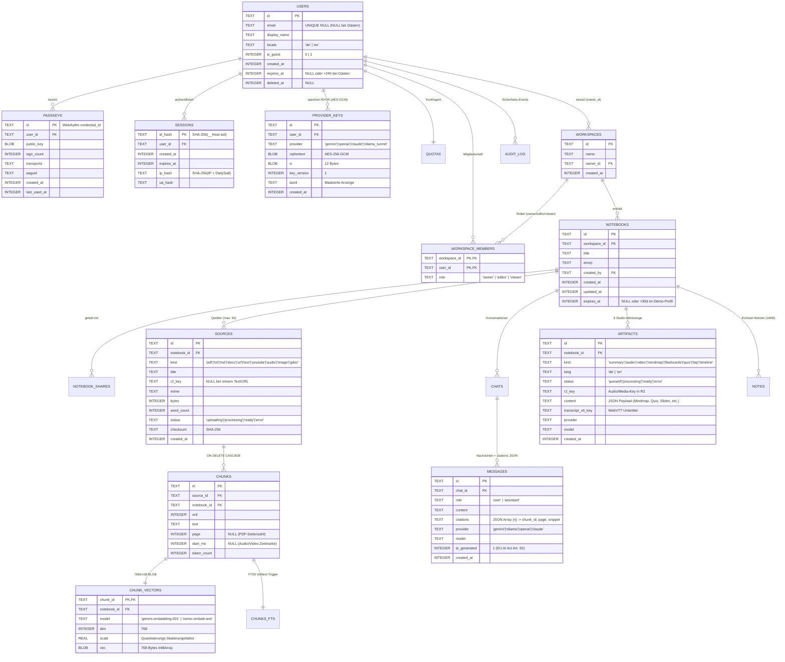

# Datenbank-Schema (Cloudflare D1 SQLite)

Stand: 2026-11-09 · Referenzen: Entscheidungen #7, #10, #32, #33, #40, #58

## 1. Entity-Relationship-Diagramm (ER-Modell)

Alle Primärschlüssel verwenden zeitlich sortierbare Text-IDs (`ULID` / `UUIDv7`). Zeitstempel werden als `INTEGER` (Unix-Epoche in Millisekunden) gespeichert. `PRAGMA foreign_keys = ON` ist in D1 standardmäßig aktiv.

---

## 2. Performance-Indizes für minimale `Rows read` in D1

Damit Abfragen im Cloudflare Free-Plan (Limit: 5 Mio. gelesene Zeilen pro Tag) keine Tabellen-Vollscans auslösen, sind folgende zusammengesetzte Indizes definiert:

| Index-Name | Tabelle & Spalten | Zweck |
|---|---|---|
| `idx_chunks_notebook_source_ord` | `chunks(notebook_id, source_id, ord)` | Geordnetes Laden von Quelltext-Abschnitten und schneller Kontext-Lookup nach `chunk_id`. |
| `idx_chunk_vectors_notebook` | `chunk_vectors(notebook_id)` | Einmaliger Kaltstart-Batch-Load aller `int8`-Vektoren eines Notebooks in den Arbeitsspeicher des `NotebookDO`. |
| `idx_sources_notebook_created` | `sources(notebook_id, created_at DESC)` | Sofortige Anzeige der Quellenliste im linken Workspace-Panel. |
| `idx_messages_chat_created` | `messages(chat_id, created_at ASC)` | Chronologisches Laden des Chat-Verlaufs ohne Sortier-Overhead. |
| `idx_sessions_expires` | `sessions(expires_at)` | Effiziente stündliche Cron-Bereinigung abgelaufener Sitzungen. |
| `idx_users_guest_expires` | `users(is_guest, expires_at)` | Automatische 24-Stunden-Löschung abgelaufener Gastkonten inkl. Kaskadierung. |
| `idx_notebooks_expires` | `notebooks(expires_at)` | Automatische 30-Tage-Bereinigung temporärer Demo-Notebooks. |
| `idx_webauthn_challenges_expires_at` | `webauthn_challenges(expires_at)` | Löschen abgelaufener WebAuthn-Challenges (bei jeder neuen Challenge und im stündlichen Cron). |

### WebAuthn-Challenges (`0003_webauthn_challenges.sql`)

Passkey-Challenges liegen in D1, nicht im Speicher einer einzelnen Worker-Instanz. Jede Challenge gilt fünf Minuten und lässt sich genau einmal verwenden: `consumeChallenge` holt sie mit `DELETE … RETURNING` in einer einzigen Anweisung heraus, eine zweite Verwendung findet nichts mehr (Replay-Schutz). Registrierungs-Challenges tragen die `user_id` und gelten nur für diese Person.

| Spalte | Typ | Bedeutung |
|---|---|---|
| `challenge_key` | `TEXT PRIMARY KEY` | `reg:<user_id>` oder `login:<challenge>` |
| `challenge` | `TEXT` | Die an den Browser ausgegebene Challenge |
| `user_id` | `TEXT NULL` | Bei Registrierung die angemeldete Person, beim Login leer |
| `created_at`, `expires_at` | `INTEGER` | Zeitstempel in ms, Ablauf nach 5 Minuten |

### Kommentare und Erwähnungen (`0005_comments.sql`, Issue #353)

Kommentare hängen an einer Quelle oder einer Notiz desselben Notebooks. SQLite kennt keinen Fremdschlüssel auf zwei Tabellen, deshalb löschen die Trigger `sources_comments_ad` und `notes_comments_ad` die Kommentare mit ihrem Ziel. Mit dem Notebook oder dem Konto der verfassenden Person verschwinden sie über `ON DELETE CASCADE`. Die Nummer 0005 lässt 0004 frei, weil ein offener PR (#388) sie belegt.

| Spalte (`comments`) | Typ | Bedeutung |
|---|---|---|
| `id` | `TEXT PRIMARY KEY` | `cmt_<uuid>` |
| `notebook_id` | `TEXT` → `notebooks.id` | Notebook, gegen das jede Anfrage geprüft wird |
| `target_type`, `target_id` | `TEXT` | `source` oder `note` und dessen ID |
| `author_id` | `TEXT` → `users.id` | verfassende Person |
| `body` | `TEXT`, 1 bis 4000 Zeichen (`CHECK`) | Klartext, wird nie als HTML ausgegeben |
| `created_at`, `updated_at` | `INTEGER` | ms; `updated_at > created_at` heißt „bearbeitet“ |

`comment_mentions(comment_id, user_id)` hält die Erwähnungen. Der Worker nimmt nur Personen an, die über den Workspace oder eine Freigabe Zugriff auf das Notebook haben. Indizes: `idx_comments_target (notebook_id, target_type, target_id, created_at)` für den Faden, `idx_comment_mentions_user (user_id)` für „Wo werde ich erwähnt“.

Rechte: Lesen ab `viewer`, Schreiben ab `editor`, Bearbeiten nur durch die verfassende Person (mit `editor`), Löschen durch die verfassende Person oder den `owner`. Ratenbegrenzung: eigene Kategorie `comments` mit 60 Anfragen je Minute und Person.
