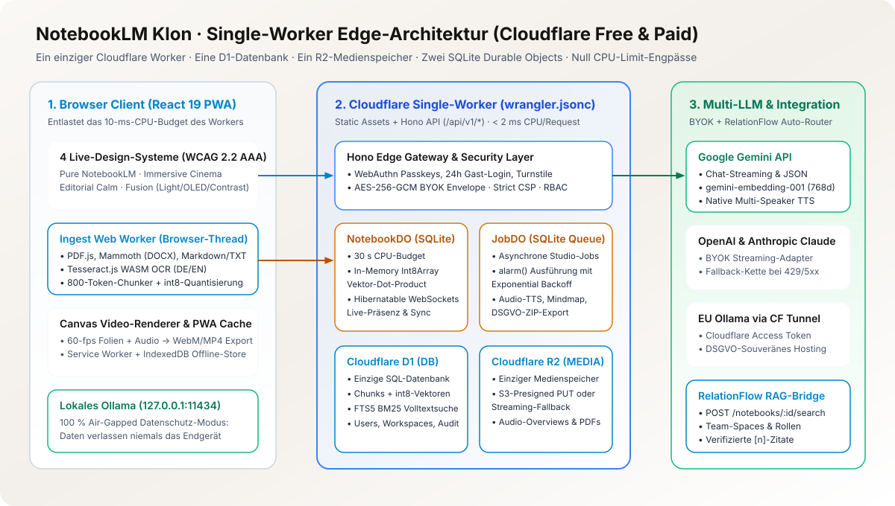
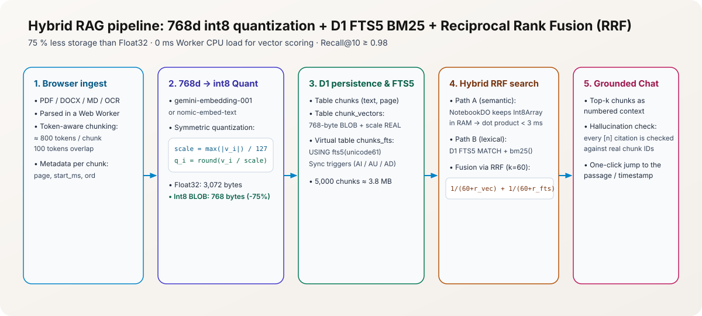
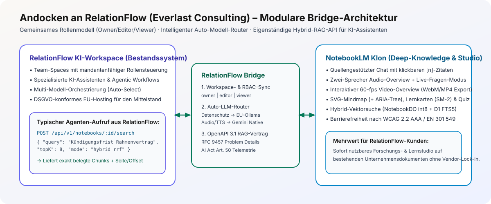
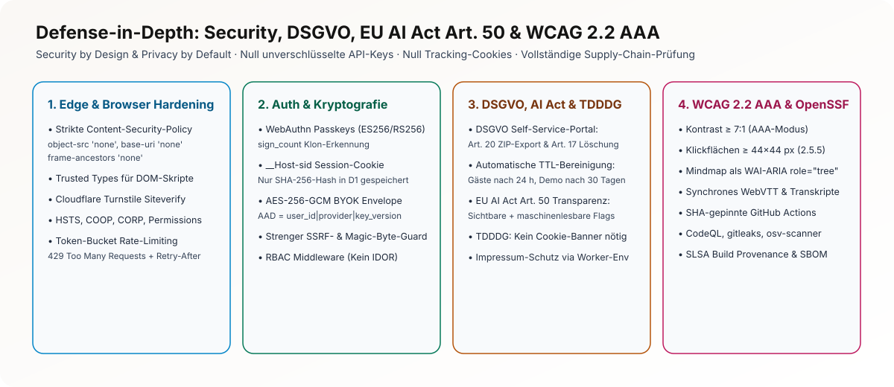

# Visueller Präsentations-Leitfaden für das 10-Minuten-Loom-Video

Stand: 2026-11-09 · Zielgruppe: Everlast Consulting GmbH (Technisches & Fachliches Review)

Dieser Leitfaden ist exakt auf eine **10-minütige Loom-Präsentation** zugeschnitten. Alle eingebetteten SVG-Schaubilder und Mermaid-Ablaufdiagramme können während der Bildschirmaufnahme direkt im GitHub-Repository oder im GitHub-Wiki geöffnet und Schritt für Schritt gezeigt werden.

---

## Zeitplan & Dramaturgie (10:00 Minuten)

| Minute | Abschnitt | Was auf dem Bildschirm gezeigt wird | Kernbotschaft für Everlast Consulting |
|---|---|---|---|
| **0:00 – 1:15** | **1. Einstieg & Live-Eindruck** | Live-App (`workers.dev`), 1-Klick-Gastzugang, Umschalten der **4 Live-Design-Systeme** (*Pure NotebookLM*, *Immersive Cinema*, *Editorial Calm*, *Fusion*) sowie Light / OLED-Dark / AAA-Hochkontrast. | Sofort ohne Registrierung testbar; eigenständige High-Craft-Oberfläche ohne generischen KI-Look; kompromisslose Barrierefreiheit (WCAG 2.2 AAA). |
| **1:15 – 3:00** | **2. RelationFlow-Workspace & Zitat-Chat** | Demo-Workspace **„RelationFlow & KI im Mittelstand“**, Rollen-Umschalter (`Owner`/`Editor`/`Viewer`), Modell-Wähler (**„Auto“**, Gemini, Ollama lokal), Chat-Frage stellen und Klick auf Zitat-Pill `[1]` $\rightarrow$ Sprung zur exakten PDF-Textstelle. | Direkte fachliche und technische Verzahnung mit Everlasts **RelationFlow**; halluzinationsfreie Antworten durch deterministische Zitat-Validierung. |
| **3:00 – 5:15** | **3. Die 6 Studio-Werkzeuge & Deep-Dive-Bühne** | Klick auf **Audio-Overview** (Immersive Cinema Bühne mit 60-fps Aurora-Orb, mitscrollendem Transkript & Live-Rückfrage **„Beitreten / Fragen“**), danach **Video-Overview** (Folien + Kapitel + `.webm`-Export), **SVG-Mindmap** (inkl. ARIA-Tree-Ansicht), **Lernkarten** & **Quiz**. | Volle Funktionsparität zu Google NotebookLM inklusive interaktivem Host-Modus und komplett clientseitigem Video-Rendering. |
| **5:15 – 7:30** | **4. Architektur-Deep-Dive (Diagramme zeigen)** | Wechsel in dieses Dokument bzw. `docs/architecture.md` und `docs/rag-and-vectors.md`: Single-Worker-Grafik, `int8`-Quantisierung und Hybrid-RRF-Suche zeigen. | Wie man auf einem einzigen Cloudflare Worker (10 ms CPU-Limit) durch Browser-Web-Worker und `NotebookDO`-RAM-Caching Enterprise-Performance zum Nulltarif erreicht. |
| **7:30 – 9:00** | **5. Andocken an RelationFlow & Security/Compliance** | Schaubild `docs/relationflow-integration.md` und `docs/security-and-compliance.md`: Eigenständige RAG-API (`POST /notebooks/:id/search`), AES-256-GCM BYOK, EU AI Act Art. 50, DSGVO-Export. | Sofort als Mikro-Modul in RelationFlow integrierbar; Security by Design; ehrliche OpenSSF- & CI/CD-Absicherung. |
| **9:00 – 10:00** | **6. Engineering-Prozess & Abschluss** | Kurzer Blick ins GitHub Project (Kanban, 44 Haupt-Issues + 132 Sub-Issues, saubere PR-Historie, 100 % UTF-8-Tests, grüne CI). | Strukturierte Arbeitsweise, transparente Dokumentation des KI-Werkzeugeinsatzes, bereit für produktiven Einsatz im Team. |

---

## Schaubild 1 für Minute 5:15 – Gesamtsystem auf einen Blick

<picture>
  <source media="(prefers-color-scheme: dark)" srcset="./assets/architecture-overview-dark.svg">
  <source media="(prefers-color-scheme: light)" srcset="./assets/architecture-overview-light.svg">
  
</picture>
Grafik in <a href="./assets/architecture-overview-de.svg" hreflang="de" lang="de">Deutsch</a> · <a href="./assets/architecture-overview-en.svg" hreflang="en" lang="en">English</a>

**Sprechpunkte dazu:**
- *„Anstatt fünf separate Cloud-Dienste zu mieten, läuft die gesamte Anwendung in **einem einzigen Cloudflare Worker** mit **einer D1-SQLite-Datenbank** und **einem R2-Bucket**.“*
- *„Der Clou gegen das harte 10-Millisekunden-CPU-Limit im Cloudflare Free-Plan: Alles Rechenintensive beim Datei-Import (PDF-Parsing, DOCX, Tesseract-WASM-OCR und Chunking) passiert im **Browser-Web-Worker** des Nutzers.“*

---

## Schaubild 2 für Minute 6:15 – Warum unsere Hybrid-Vektorsuche so schnell ist

<picture>
  <source media="(prefers-color-scheme: dark)" srcset="./assets/rag-pipeline-dark.svg">
  <source media="(prefers-color-scheme: light)" srcset="./assets/rag-pipeline-light.svg">
  
</picture>
Grafik in <a href="./assets/rag-pipeline-de.svg" hreflang="de" lang="de">Deutsch</a> · <a href="./assets/rag-pipeline-en.svg" hreflang="en" lang="en">English</a>

**Sprechpunkte dazu:**
- *„Wir speichern 768-dimensionale Embeddings symmetrisch `int8`-quantisiert in D1. Das spart **75 % Speicherplatz** (768 Bytes statt 3 KB pro Chunk).“*
- *„Das Vektor-Scoring läuft im `NotebookDO` Durable Object im Arbeitsspeicher: 5.000 Chunks werden in **unter 3 Millisekunden** per Dot-Product durchsucht, kombiniert mit SQLite `FTS5` BM25 über Reciprocal Rank Fusion.“*

---

## Schaubild 3 für Minute 7:30 – Das Andock-Konzept an Everlasts RelationFlow

<picture>
  <source media="(prefers-color-scheme: dark)" srcset="./assets/relationflow-bridge-dark.svg">
  <source media="(prefers-color-scheme: light)" srcset="./assets/relationflow-bridge-light.svg">
  
</picture>
Grafik in <a href="./assets/relationflow-bridge-de.svg" hreflang="de" lang="de">Deutsch</a> · <a href="./assets/relationflow-bridge-en.svg" hreflang="en" lang="en">English</a>

**Sprechpunkte dazu:**
- *„Ich habe mir RelationFlow genau angesehen: Team-Workspaces mit Rollen, Multi-Modell-Auswahl inklusive Auto-Routing und DSGVO-konformes EU-Hosting.“*
- *„Deshalb besitzt unser Klon exakt kompatible Workspace-Rollen (`owner`, `editor`, `viewer`), denselben **Auto-Modell-Router** (der bei sensiblen Daten automatisch auf lokales oder EU-getunneltes Ollama schaltet) und eine eigenständige **OpenAPI-3.1-RAG-Schnittstelle (`POST /api/v1/notebooks/:id/search`)**, die jeder RelationFlow-Agent direkt als Wissens-Tool aufrufen kann.“*

---

## Schaubild 4 für Minute 8:15 – Security, DSGVO, EU AI Act & WCAG 2.2 AAA

<picture>
  <source media="(prefers-color-scheme: dark)" srcset="./assets/security-layers-dark.svg">
  <source media="(prefers-color-scheme: light)" srcset="./assets/security-layers-light.svg">
  
</picture>
Grafik in <a href="./assets/security-layers-de.svg" hreflang="de" lang="de">Deutsch</a> · <a href="./assets/security-layers-en.svg" hreflang="en" lang="en">English</a>

**Sprechpunkte dazu:**
- *„Nutzer-API-Keys werden per `AES-256-GCM` mit zusätzlichem Kontext-Binding (`AAD`) verschlüsselt; Passkeys schützen vor Phishing und erfüllen gleichzeitig WCAG 2.2 Accessible Authentication.“*
- *„Für den **EU AI Act (Art. 50)** sind alle generierten Texte, Audio-Stimmen und Video-Exporte sowohl sichtbar als auch maschinenlesbar gekennzeichnet.“*
