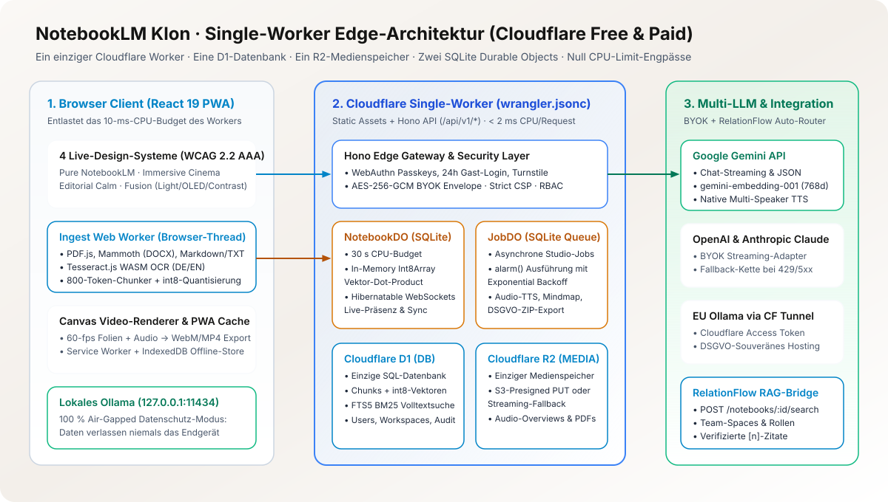
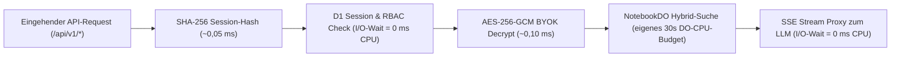

# Cloudflare Free-Tier-Limits, CPU-Budgets & Architekturentscheidungen

Stand: 2026-11-14 · Verifiziert durch automatisierte Tests (`fts5-probe.test.ts`, `crypto-benchmark.test.ts`)

<picture>
  <source media="(prefers-color-scheme: dark)" srcset="./assets/architecture-overview-dark.svg">
  <source media="(prefers-color-scheme: light)" srcset="./assets/architecture-overview-light.svg">
  
</picture>
<sub>Grafik in <a href="./assets/architecture-overview-de.svg" hreflang="de" lang="de">Deutsch</a> · <a href="./assets/architecture-overview-en.svg" hreflang="en" lang="en">English</a></sub>

## 1. Übersicht der harten Plattform-Grenzen (Cloudflare Free vs. Paid)

Der NotebookLM-Klon läuft vollständig auf **einem einzigen Cloudflare Worker**, **einer D1-SQLite-Datenbank**, **einem R2-Medienspeicher** und **zwei SQLite-backed Durable Objects** (`NotebookDO` und `JobDO`). Damit die Live-Demo dauerhaft kostenlos im Cloudflare Free-Plan betrieben werden kann und gleichzeitig per Konfigurationsumschaltung (`APP_PROFILE=full`) ohne Codeänderung auf Unternehmenslast skaliert, wurden alle harten Plattform-Limits technisch verifiziert:

| Dienst | Cloudflare Free-Tier-Limit | Auswirkung auf das System | Unsere architektonische Lösung |
|---|---|---|---|
| **Cloudflare Workers** | 100.000 Requests/Tag, **10 ms CPU-Zeit pro Request**, 128 MB RAM, 50 Subrequests | Rechenintensive Arbeit im Worker (PDF-Parsing, OCR, Vektor-Scan über tausende Chunks, PBKDF2 mit hohen Iterationen) führt sofort zu `Error 1102 (CPU time limit exceeded)`. | Der Worker führt nur leichtgewichtige Aufgaben aus (Auth, Zod-Validierung, DB-Persistenz, SSE-Streaming-Proxy; reine Wartezeit auf LLM-Streams zählt **nicht** als CPU-Zeit). Schwere Berechnungen liegen im **Browser-Web-Worker** (Parsing/OCR/Chunking) oder im **Durable Object** (`NotebookDO` mit 30 s CPU-Budget). |
| **Cloudflare D1 (SQLite)** | 5 Mio. Rows read/Tag, 100.000 Rows written/Tag, 500 MB pro DB, max. 50 Queries/Invocation | Ein Vollscan über 50.000 Vektor-Zeilen bei jeder Chat-Anfrage würde das tägliche Read-Limit nach 100 Suchanfragen erschöpfen. | **Symmetrische `int8`-Quantisierung** (768 Bytes statt 3.072 Bytes pro Vektor) + **In-Memory-Cache im `NotebookDO`**: Die Vektoren eines Notebooks werden nur beim Kaltstart einmal aus D1 geladen und danach im RAM des `NotebookDO` per schnellem Dot-Product durchsucht. D1 führt parallel nur die indexierte `FTS5`-BM25-Suche aus. |
| **Cloudflare R2** | 10 GB-Monat Speicher, 1 Mio. Class-A-Ops (u. a. PutObject, ListObjects), 10 Mio. Class-B-Ops (u. a. GetObject, HeadObject) je Monat, **Egress kostenlos** ([Quelle](https://developers.cloudflare.com/r2/pricing/), abgerufen 2026-11-14) | Große Quelldateien (bis 50 MB je Datei und 200 MB je Notebook, in beiden Profilen) dürfen den Worker-Speicher (128 MB) nicht sprengen. Ohne Grenzen könnten Uploads die Freimenge aufbrauchen. | Gestreamter Upload über das `MEDIA`-Binding mit Byte-Zählung; Presigned URL (Entscheidung #57) nur im Profil `full`. Grenzen je Datei, Notebook, Nutzer, Gast und Tag halten den Verbrauch bei höchstens der Hälfte der Freimenge (Abschnitt 5). Cron räumt Gäste nach 24 h, Demo-Notebooks nach 30 Tagen und abgebrochene Uploads nach 1 h weg. |
| **Durable Objects (SQLite)** | 100.000 Requests/Tag, 13.000 GB-s/Tag, 5 GB SQLite-Speicher (`new_sqlite_classes`), **30 s CPU-Budget pro Aufruf** | Im Free-Plan sind ausschließlich SQLite-backed Durable Objects (`new_sqlite_classes`) zulässig. | `NotebookDO` (Echtzeit-WebSockets mit Hibernation + In-Memory-`Int8Array`-Vektorsuche) und `JobDO` (persistente Hintergrund-Job-Queue via `alarm()` ohne separates Cloudflare-Queues-Abo). |
| **Email Sending** | Im Free-Plan Versand **nur an vorab verifizierte eigene Zieladressen**; Versand an beliebige fremde Adressen erfordert Workers Paid oder Drittanbieter. | E-Mail-Magic-Link kann im reinen Cloudflare-Free-Plan nicht an unbekannte Bewerbungsprüfer senden. | Primäre Anmeldung über **WebAuthn Passkeys** + **1-Klick-Gastzugang (24 h)** (sofort ohne E-Mail testbar). Für Magic-Link ist ein Multi-Provider-Adapter (`cloudflare`, optionaler kostenloser `resend`/`brevo`-Key oder `console` im Dev-Modus) integriert (Entscheidung #56). |
| **Workers AI** (Stand 2026-11-14) | **10.000 Neuronen pro Tag**, Reset 00:00 UTC; danach im Free-Plan Fehler statt Abrechnung. Text-Embeddings: 3.000 Anfragen/Minute. `@cf/google/embeddinggemma-2`: 154 Neuronen je Mio. Eingabe-Tokens (≈ 64,9 Mio. Tokens/Tag) | Ohne serverseitige Embeddings bleibt die Vektorsuche bei hochgeladenen Quellen leer; ein unbegrenzter Verbrauch würde das Tageskontingent für alle sperren. | Binding `AI`, Embeddings beim Chunk-Ingest und für Suchanfragen, Tagesbudget 50 Mio. Tokens (77 % der freien Menge), je Gast 1 Mio. Tokens, Zähler in D1 (`ai_embedding_usage`), 60 s Fehlerpause. Ohne Binding, über Budget oder bei Fehlern: Rückfall auf FTS5. Details und Quellen: [rag-and-vectors.md, Abschnitt 5](./rag-and-vectors.md#5-serverseitige-embeddings-über-workers-ai-kostenlose-stufe). |

---

## 2. Verifikation des 10-ms-CPU-Budgets (WebCrypto Benchmark)

Um sicherzustellen, dass Authentifizierung, Session-Prüfung und die Entschlüsselung von Nutzer-API-Keys (BYOK) niemals das 10-ms-CPU-Limit des Cloudflare Free-Plans reißen, setzen wir ausschließlich auf native C++/Rust-gestützte **WebCrypto-Primitive (`crypto.subtle`)** statt auf JavaScript-Kryptobibliotheken.

Die automatisierte Benchmark-Suite ([`apps/worker/src/crypto-benchmark.ts`](../apps/worker/src/crypto-benchmark.ts) & [`crypto-benchmark.test.ts`](../apps/worker/src/__tests__/crypto-benchmark.test.ts)) misst bei jedem Testlauf die reale CPU-Zeit pro Operation:

| Kryptografische Operation | Einsatzgebiet im Worker | Gemessene Ø CPU-Zeit | Ziel-Budget | Status |
|---|---|---|---|---|
| `SHA-256` (`crypto.subtle.digest`) | Session-Token-Hashing (`__Host-sid`), Magic-Link-Token, datenschutzfreundliches IP-Hashing | **< 0,05 ms** | < 2,00 ms | Grün |
| `AES-256-GCM` (`encrypt` + `decrypt` mit AAD) | Envelope-Verschlüsselung & Entschlüsselung der BYOK-Provider-Keys (`user_id\|provider\|key_version`) | **< 0,15 ms** | < 2,00 ms | Grün |
| `ECDSA P-256` (`crypto.subtle.verify`) | WebAuthn Passkey Assertion-Verifikation beim Login | **< 0,40 ms** | < 2,00 ms | Grün |
| **Summe aller Krypto-Schritte pro Request** | Vollständiger authentifizierter API-Aufruf inkl. BYOK-Key-Entschlüsselung | **< 0,60 ms** | **< 5,00 ms** (von 10 ms Limit) | **Grün (> 90 % Reserve)** |



---

## 3. Verifikation von SQLite `FTS5` & `bm25()` in Cloudflare D1

Cloudflare D1 basiert auf SQLite und unterstützt virtuelle Volltext-Tabellen über das `fts5`-Modul. In [`apps/worker/src/fts5-probe.ts`](../apps/worker/src/fts5-probe.ts) und [`fts5-probe.test.ts`](../apps/worker/src/__tests__/fts5-probe.test.ts) wird dieser Mechanismus automatisiert geprüft:

1. **Virtuelle Tabelle mit `unicode61`-Tokenizer:**
   `CREATE VIRTUAL TABLE chunks_fts USING fts5(text, content='chunks', content_rowid='rowid', tokenize='unicode61 remove_diacritics 2')` – unterstützt deutsche Umlaute (`ä, ö, ü, ß`) und Fachbegriffe zuverlässig.
2. **Automatische Trigger-Synchronisation:**
   `AFTER INSERT`, `AFTER UPDATE` und `AFTER DELETE` Trigger halten den Volltextindex synchron zur `chunks`-Tabelle, ohne dass zusätzliche Worker-Subrequests nötig sind.
3. **Sichere Query-Sanitisierung (`buildSafeFts5MatchQuery`):**
   Nutzereingaben mit Sonderzeichen (z. B. `DSGVO & KI-Verordnung (EU AI Act)!`) werden vor der `MATCH`-Abfrage in exakt gequotete Wort-Tokens (`"DSGVO" "KI" "Verordnung" "EU" "AI" "Act"`) zerlegt, um FTS5-Syntaxfehler und SQL/FTS-Injection auszuschließen.
4. **Relevanz-Ranking via `bm25()`:**
   Liefert die lexikalischen Top-$k$-Treffer für die anschließende **Reciprocal Rank Fusion (RRF)** mit den semantischen `int8`-Vektor-Treffern aus dem `NotebookDO`.

---

## 4. Konfigurationsprofile (`demo` vs. `full`)

Über [`apps/worker/src/config.ts`](../apps/worker/src/config.ts) schaltet die Umgebungsvariable `APP_PROFILE` verlustfrei zwischen dem öffentlichen Demo-Betrieb (optimiert auf die Cloudflare Free-Tier-Kontingente) und dem produktiven Vollausbau um:

| Kontingent / Parameter | Profil `demo` (Cloudflare Free) | Profil `full` (Vollausbau / Enterprise) |
|---|---|---|
| Max. Notebooks pro Nutzer | 3 | 100 |
| Max. Quellen pro Notebook | 50 | 50 |
| Max. Chunks pro Notebook | 5.000 (≈ 3,8 MB `int8`-Vektoren) | 50.000 (≈ 38 MB `int8`-Vektoren) |
| Max. Dateigröße pro Quelle | 50 MB | 50 MB |
| Max. Gesamtgröße pro Notebook | 200 MB | 200 MB |
| Max. Wörter pro Quelle | 500.000 | 500.000 |
| Max. LLM-Aufrufe pro Nutzer/Tag | 50 | 2.000 |
| Gast-Konto Lebensdauer (TTL) | 24 Stunden | 24 Stunden |
| Demo-Notebook Lebensdauer (TTL) | 30 Tage | Unbegrenzt (`null`) |

### 4.1 Durchsetzung und Fehlercodes

Der Worker prüft die Grenzen serverseitig, bevor etwas gespeichert wird (`quotaGuardMiddleware` vor `POST /api/v1/notebooks/:id/sources`, Prüfung im URL-Import, Byte-Zählung beim Upload). Abgelehnte Anfragen erhalten eine Antwort nach RFC 9457 (`application/problem+json`). Das Feld `detail` ist deutsch; sendet der Client `Accept-Language: en…` an erster Stelle, kommt es auf Englisch.

| Grenze | Wert | Genau am Limit | Ab +1 Byte bzw. +1 Quelle | HTTP | `code` |
|---|---|---|---|---|---|
| Dateigröße je Quelle | 50 MB (52.428.800 Byte) | erlaubt | abgelehnt | 403 bzw. 413 | `QUOTA_MAX_SOURCE_BYTES_EXCEEDED` (403, Kontingentprüfung, greift im API-Pfad zuerst), `FILE_TOO_LARGE` (413, Prüfung im Upload-Handler) |
| Summe aller Quellen je Notebook | 200 MB (209.715.200 Byte) | erlaubt | abgelehnt | 413 | `NOTEBOOK_SIZE_LIMIT` |
| Quellen je Notebook | 50 | die 50. Quelle ist erlaubt | die 51. wird abgelehnt | 403 | `QUOTA_MAX_SOURCES_PER_NOTEBOOK_EXCEEDED` |

Beispiel für `NOTEBOOK_SIZE_LIMIT`:

```json
{
  "type": "about:blank",
  "title": "Payload Too Large",
  "status": 413,
  "detail": "Notizbuch-Limit von 200 MB überschritten: aktuell 160 MB, die neue Quelle (40 MB) würde das Limit sprengen.",
  "instance": "/api/v1/notebooks/nb_123/sources",
  "code": "NOTEBOOK_SIZE_LIMIT"
}
```

Die Grenzwerte stehen in [`apps/worker/src/config.ts`](../apps/worker/src/config.ts), die Prüfungen in [`apps/worker/src/quota-guard.ts`](../apps/worker/src/quota-guard.ts). Tests an den Grenzen (genau am Limit und 1 Byte darüber): `apps/worker/src/__tests__/security-headers-quotas.test.ts` und `apps/worker/src/__tests__/sources-upload.test.ts`.


---

## 5. R2-Freimenge und Upload-Grenzen (Entscheidung F247)

Eigene Uploads liegen im eigenen Bucket `notebook-lm-media`. Im Profil `demo` hält der Worker den Verbrauch bei höchstens der Hälfte der Cloudflare-Freimenge. Die andere Hälfte bleibt Reserve für Rundung (Cloudflare rundet auf die nächste Abrechnungseinheit), verwaiste Objekte und andere Nutzung desselben Kontos.

### 5.1 Freimenge laut Cloudflare

Quelle: <https://developers.cloudflare.com/r2/pricing/>, abgerufen am 2026-11-14.

| Posten | Freimenge je Monat | Was zählt |
|---|---|---|
| Speicher (Standard) | 10 GB-Monat | Durchschnitt des täglichen Höchststands über 30 Tage |
| Class-A-Operationen | 1.000.000 | u. a. `PutObject`, `ListObjects`, `CreateMultipartUpload` |
| Class-B-Operationen | 10.000.000 | u. a. `GetObject`, `HeadObject` |
| Egress | kostenlos | über Workers-API, S3-API und `r2.dev` |
| `DeleteObject` | kostenlos | |

Die Doku sagt nicht, ob die Freimenge je Konto oder je Bucket gilt. Wir rechnen vorsichtig mit „je Konto“. In den Konstanten ist „GB“ dezimal angesetzt (10.000.000.000 Byte), das ist die kleinere Lesart.

### 5.2 Grenzen und Rechnung

Alle Werte stehen als benannte Konstanten in [`apps/worker/src/r2-budget.ts`](../apps/worker/src/r2-budget.ts) und im Profil in [`apps/worker/src/config.ts`](../apps/worker/src/config.ts). Vorhandene Grenzen werden weiterverwendet, nicht doppelt definiert.

| Grenze | `demo` | `full` | Herkunft |
|---|---|---|---|
| Dateigröße je Upload | 50 MB | 50 MB | vorhanden (`MAX_SOURCE_BYTE_SIZE_LIMIT`, `maxSourceBytes`) |
| Quellen je Notebook | 50 | 50 | vorhanden (`maxSourcesPerNotebook`) |
| Summe je Notebook | 200 MB | 200 MB | vorhanden (`maxNotebookBytes`) |
| Speicher je angemeldetem Nutzer | 500 MB | 20 GB | neu (`MAX_USER_STORAGE_BYTES`) |
| Speicher je Gast | 100 MB | 100 MB | neu (`MAX_GUEST_STORAGE_BYTES`) |
| Gesamtspeicher aller Quellen | 5 GB | keine Grenze | neu (`R2_STORAGE_BUDGET_BYTES` = 10 GB × 0,5) |
| Uploads je UTC-Tag, alle Nutzer | 1.000 | keine Grenze | neu (`MAX_UPLOADS_PER_DAY`) |
| Upload-Bytes je UTC-Tag, alle Nutzer | 2 GB | keine Grenze | neu (`MAX_UPLOAD_BYTES_PER_DAY`) |
| Abgebrochener Upload gilt als verwaist nach | 1 h | 1 h | neu (`STALE_UPLOAD_MS`) |

Rechnung für das Profil `demo` bei voll ausgeschöpftem Tageslimit über 31 Tage:

- **Speicher:** Der Gesamtspeicher ist zu jedem Zeitpunkt auf 5 GB begrenzt. Damit liegt auch der tägliche Höchststand und dessen Monatsdurchschnitt bei höchstens 5 GB-Monat, also 50 % der Freimenge. Gezählt wird beim Anmelden des Uploads (Reservierung), nicht erst nach dem Hochladen.
- **Class A:** je Upload ein `PutObject` und höchstens ein `ListObjects` beim späteren Aufräumen: 1.000 × 31 × 2 = 62.000 Operationen, 6,2 % der Freimenge.
- **Class B:** je Upload ein `GetObject` auf die ersten 512 Byte beim Abschluss: 1.000 × 31 × 1 = 31.000 Operationen, 0,31 % der Freimenge. Downloads über `GET /api/v1/sources/:id/file` kommen dazu. Sie sind nur über das allgemeine Rate-Limit begrenzt; für sie bleiben rund 9,9 Mio. Operationen im Monat, gut 300.000 am Tag.
- **Egress:** kostenlos, keine Grenze nötig.

Ein Test prüft diese Rechnung bei jeder Änderung der Konstanten (`upload-limits.test.ts`, „bleibt bei vollem Tageslimit über 31 Tage unter 10 % der Class-A- und 1 % der Class-B-Operationen“).

### 5.3 Durchsetzung im Worker

Alles wird serverseitig geprüft, der Browser prüft nur zusätzlich.

1. **Kontingent vor dem Anlegen** (`quotaGuardMiddleware` vor `POST /api/v1/notebooks/:id/sources`): Dateigröße, Quellen und Bytes je Notebook wie bisher, neu der Speicher je Nutzer bzw. Gast. Gezählt wird die Summe `byte_size` aller Quellen in den Notebooks des Notebook-Eigentümers (`notebooks.created_by`); lädt ein Mitbearbeiter hoch, zählt die Datei beim Eigentümer.
2. **Globale Grenzen im Upload-Handler** (`reserveUploadBudget`): Gesamtspeicher aus der Zählertabelle `r2_usage`, die Trigger auf `sources` synchron halten, auch bei Löschungen per Kaskade. Der Tageszähler `upload_daily` wird mit einem bedingten UPSERT atomar erhöht, gleichzeitige Uploads können die Grenze also nicht gemeinsam überschreiten.
3. **Nur gestreamter Upload im Profil `demo`:** Eine Presigned URL würde den Worker umgehen, R2 könnte dann bis zu 5 GiB je Objekt annehmen. Im Profil `demo` gibt der Worker deshalb auch mit gesetzten S3-Schlüsseln nur `mode: "worker-upload"` aus.
4. **Beim Streamen:** `Content-Length` ist Pflicht und darf die angemeldete Größe nicht übersteigen. Zusätzlich zählt `limitStream` die tatsächlich ankommenden Bytes und bricht ab, sobald es mehr werden. In der Workers-Laufzeit geht der Stream durch einen `FixedLengthStream`, R2 kennt damit die Länge. Bei Abbruch oder Speicherfehler löscht der Worker das R2-Objekt und setzt die Quelle auf `error`.
5. **Beim Abschluss:** Ist das gespeicherte Objekt größer als angemeldet oder schlägt die Magic-Byte-Prüfung fehl, löscht der Worker das Objekt.
6. **Cron (stündlich):** Quellen, die länger als 1 h im Status `uploading` hängen, werden samt R2-Objekt gelöscht; die Trigger geben den reservierten Speicher frei. Abgelaufene Gäste und Demo-Notebooks werden wie bisher samt allen Objekten unter `notebooks/<id>/` gelöscht, also auch ihre Uploads. Tageszähler älter als 7 Tage werden entfernt.

### 5.4 Fehlercodes (RFC 9457)

| Situation | HTTP | `code` | UI-Text (Schlüssel) |
|---|---|---|---|
| Speicher je Nutzer voll | 403 | `QUOTA_MAX_USER_STORAGE_EXCEEDED` | `srcErrorStorage` |
| Speicher je Gast voll | 403 | `QUOTA_MAX_GUEST_STORAGE_EXCEEDED` | `srcErrorStorage` |
| Tageslimit der Instanz erreicht | 503 + `Retry-After` bis 00:00 UTC | `UPLOAD_DAILY_LIMIT_REACHED` | `srcErrorCapacity` |
| Gesamtspeicher der Instanz voll | 507 | `STORAGE_BUDGET_EXHAUSTED` | `srcErrorCapacity` |
| Body größer als `Content-Length` | 413 | `UPLOAD_TOO_LARGE` | `srcErrorSize` |
| Gespeichertes Objekt größer als angemeldet | 413 | `UPLOAD_SIZE_MISMATCH` | `srcErrorSize` |

Die UI-Texte gibt es auf Deutsch, Englisch und in Leichter Sprache (`translations-areas.ts`, `locales/de-x-ls.json`).

### 5.5 Was diese Grenzen nicht leisten

- Sie gelten nur für diese App. Andere Buckets, Worker oder manuelle Uploads im selben Konto zählen zur selben Freimenge. Den tatsächlichen Verbrauch zeigt nur das Cloudflare-Dashboard.
- Downloads sind nicht eigens gezählt (siehe 5.2).
- Schlägt beim Löschen einer Quelle das Löschen in R2 fehl, bleibt das Objekt verwaist, während der Zähler den Speicher schon freigegeben hat. Ein Abgleich von R2-Objekten gegen D1 fehlt noch.
- Die Prüfung des Gesamtspeichers liest den Zähler und reserviert danach; zwei gleichzeitige Uploads können die 5-GB-Grenze um höchstens eine Dateigröße überschreiten. Die Reserve von 50 % fängt das ab.
- Im Profil `full` gibt es keine globalen Grenzen. Es ist für einen bezahlten Plan gedacht.
