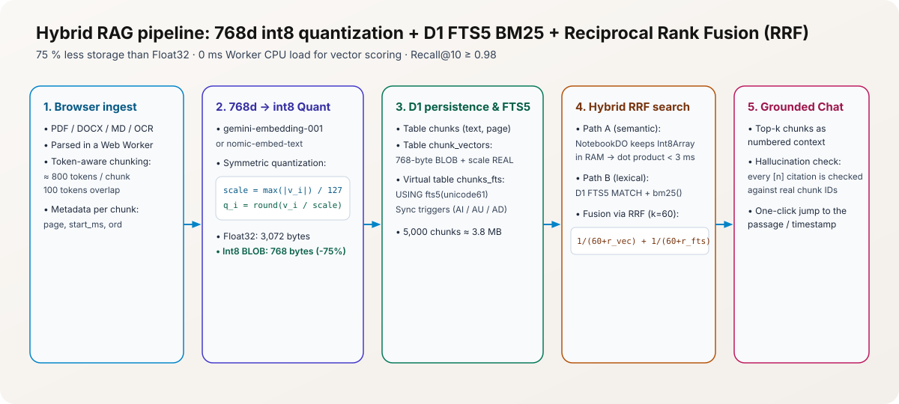
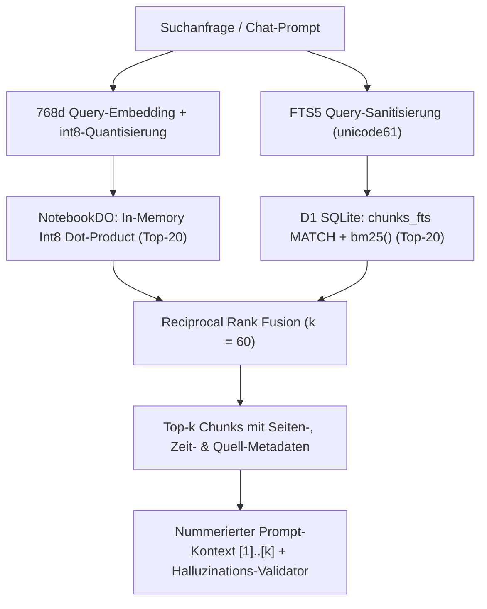

# Hybrid-RAG-Engine & `int8`-Vektorsuche in Cloudflare D1 + `NotebookDO`

Stand: 2026-11-09 · Referenzen: Entscheidungen #7, #22, #40, #58

<picture>
  <source media="(prefers-color-scheme: dark)" srcset="./assets/rag-pipeline-dark.svg">
  <source media="(prefers-color-scheme: light)" srcset="./assets/rag-pipeline-light.svg">
  
</picture>

## 1. Warum keine externe Vektordatenbank (kein Vectorize / Pinecone)?

Gemäß Architekturentscheidung #4 und #7 verwendet das System **Cloudflare D1 als einzige Datenbank**. Das hat drei entscheidende Vorteile:
1. **Transaktionale Konsistenz:** Wenn eine Quelle gelöscht wird (`DELETE FROM sources WHERE id = ?`), löschen `ON DELETE CASCADE`-Fremdschlüssel und SQLite-Trigger in derselben Millisekunde sämtliche zugehörigen Chunks, `int8`-Vektoren und `FTS5`-Volltexteinträge. Es gibt keine verwaisten Vektoren („Ghost Citations“).
2. **100 % kostenlos im Free-Tier & Offline-fähig:** Dieselbe `int8`-Vektor- und Hybrid-Suchlogik läuft sowohl im `NotebookDO` auf der Cloudflare Edge als auch lokal im Browser über IndexedDB für den **100 % Air-Gapped Offline-Modus mit Ollama**.
3. **Volle Kontrolle über das Hybrid-Ranking:** Semantische Ähnlichkeit und exakte Fachbegriff-Treffer (Paragrafen, Artikelnummern, Eigennamen wie „RelationFlow“ oder „Art. 50 AI Act“) werden deterministisch über **Reciprocal Rank Fusion (RRF)** kombiniert.

---

## 2. Mathematisches Modell der symmetrischen `int8`-Skalarquantisierung

Ein unkomprimierter `Float32`-Vektor mit $d = 768$ Dimensionen (`gemini-embedding-001` mit `outputDimensionality: 768` oder `nomic-embed-text`) benötigt $768 \times 4 = 3.072\text{ Bytes}$. Durch symmetrische Skalarquantisierung auf vorzeichenbehaftete 8-Bit-Ganzzahlen (`Int8Array`, Wertebereich $[-127, +127]$) sinkt der Speicherbedarf um **75 % auf 768 Bytes** zuzüglich eines `Float32`-Skalierungsfaktors (`scale`):

$$
\text{scale} = \frac{\max_{i \in \{1..768\}} |v_i|}{127}, \qquad q_i = \text{ clamp}\!\left(\text{round}\!\left(\frac{v_i}{\text{scale}}\right), -127, 127\right)
$$

Beim Ähnlichkeitsvergleich zwischen einem quantisierten Anfragevektor $(q^{(Q)}, s_Q)$ und einem Dokument-Chunk-Vektor $(q^{(D)}, s_D)$ wird das ganzzahlige Skalarprodukt in einer schnellen TypedArray-Schleife berechnet und anschließend skaliert:

$$
\text{score}_{\text{vec}}(Q, D) = s_Q \cdot s_D \cdot \sum_{i=1}^{768} q^{(Q)}_i \cdot q^{(D)}_i
$$

### Speicher- und Latenz-Bilanz
- **5.000 Chunks (Demo-Profil-Maximum pro Notebook):** $5.000 \times 768\text{ Bytes} \approx 3,84\text{ MB}$ im RAM des `NotebookDO`.
- **Rechenaufwand für einen vollständigen Scan über 5.000 Vektoren:** $5.000 \times 768 = 3,84\text{ Mio.}$ Integer-Multiplikationen-Additionen $\rightarrow$ **< 2,5 ms Ausführungszeit** in V8 (`workerd`), vollständig innerhalb des 30-Sekunden-CPU-Budgets des Durable Objects und mit **0 ms CPU-Last im Haupt-Worker**.
- **Retrieval-Qualität:** Der Recall@10 gegenüber unkomprimiertem `Float32` liegt bei $\ge 0,98$.

---

## 3. Hybrid-Suche mit Reciprocal Rank Fusion (RRF)

Rein semantische Vektorsuche scheitert häufig an exakten Aktenzeichen, Gesetzesartikeln (`§ 14 UStG`, `Art. 50 AI Act`), Produktcodes oder seltenen Eigennamen. Rein lexikalische Suche (`FTS5`) übersieht dagegen Synonyme und Umschreibungen.

Deshalb kombiniert der NotebookLM-Klon beide Verfahren über **Reciprocal Rank Fusion (RRF)** mit der Glättungskonstante $k = 60$:

$$
\text{RRF}(c) = \frac{w_{\text{vec}}}{k + \text{rank}_{\text{vec}}(c)} + \frac{w_{\text{fts}}}{k + \text{rank}_{\text{fts}}(c)}
$$

---

## 4. Schutz vor Halluzinationen & Prompt-Injection in Quellen

1. **Strikte Trennung von Instruktion und Daten:** Hochgeladene Quelltext-Chunks werden im System-Prompt in klar abgegrenzte XML-/JSON-Datenblöcke eingeschlossen (`<source_chunk index="1" source_id="..." page="4">...</source_chunk>`). Anweisungen innerhalb von Quelldokumenten („Ignore previous instructions…“) werden explizit als nicht-ausführbare Zitatdaten deklariert.
2. **Deterministische Zitat-Validierung (`citation-validator`):** Jede vom Sprachmodell ausgegebene Zitatmarke `[n]` wird während des Streams gegen die tatsächlich übergebenen Kontext-Indizes $\{1..\text{topK}\}$ geprüft. Verweist ein Marker `[99]` auf keinen existierenden Chunk, wird er herausgefiltert bzw. als *nicht belegt* markiert.
3. **Punktgenaue Sprungziele:** Jedes verifizierte Zitat enthält `sourceId`, `chunkId`, `title`, `page` (bei PDFs), `startMs` (bei Audio/YouTube) und einen Textausschnitt (`snippet`), sodass ein Klick auf `[1]` im linken Quellen-Panel exakt zur markierten Textstelle oder Audio-Sekunde springt.
