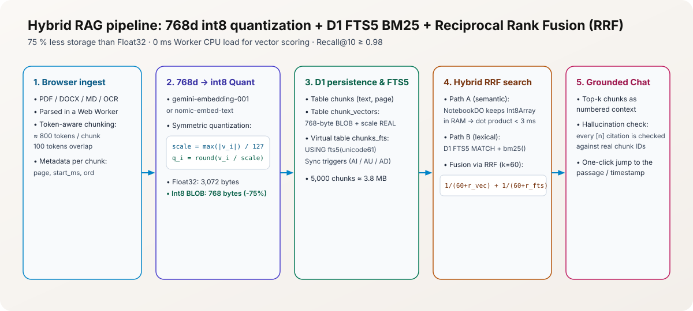
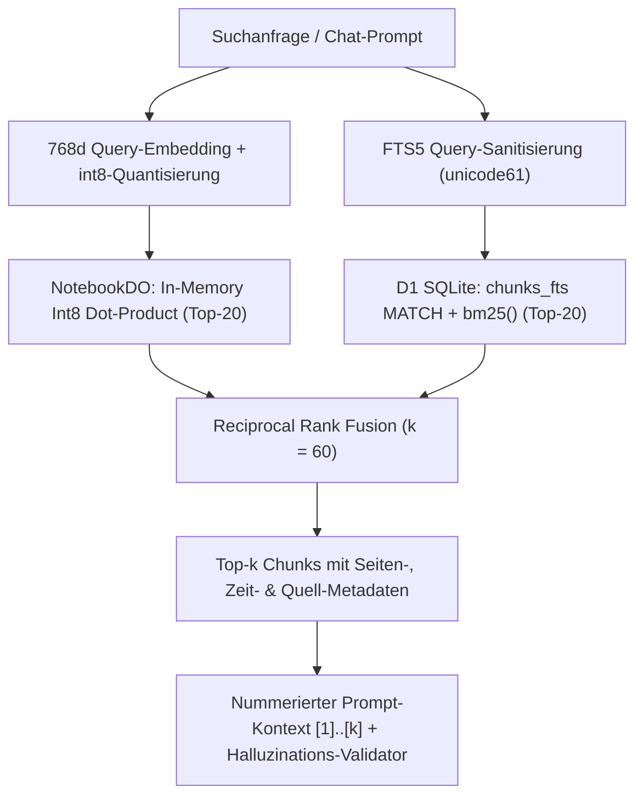

# Hybrid-RAG-Engine & `int8`-Vektorsuche in Cloudflare D1 + `NotebookDO`

Stand: 2026-11-14 · Referenzen: Entscheidungen #7, #22, #40, #58

<picture>
  <source media="(prefers-color-scheme: dark)" srcset="./assets/rag-pipeline-dark.svg">
  <source media="(prefers-color-scheme: light)" srcset="./assets/rag-pipeline-light.svg">
  
</picture>
Grafik in <a href="./assets/rag-pipeline-de.svg" hreflang="de" lang="de">Deutsch</a> · <a href="./assets/rag-pipeline-en.svg" hreflang="en" lang="en">English</a>

## 1. Warum keine externe Vektordatenbank (kein Vectorize / Pinecone)?

Gemäß Architekturentscheidung #4 und #7 verwendet das System **Cloudflare D1 als einzige Datenbank**. Das hat drei entscheidende Vorteile:
1. **Transaktionale Konsistenz:** Wenn eine Quelle gelöscht wird (`DELETE FROM sources WHERE id = ?`), löschen `ON DELETE CASCADE`-Fremdschlüssel und SQLite-Trigger in derselben Millisekunde sämtliche zugehörigen Chunks, `int8`-Vektoren und `FTS5`-Volltexteinträge. Es gibt keine verwaisten Vektoren („Ghost Citations“).
2. **100 % kostenlos im Free-Tier & Offline-fähig:** Dieselbe `int8`-Vektor- und Hybrid-Suchlogik läuft sowohl im `NotebookDO` auf der Cloudflare Edge als auch lokal im Browser über IndexedDB für den **100 % Air-Gapped Offline-Modus mit Ollama**.
3. **Volle Kontrolle über das Hybrid-Ranking:** Semantische Ähnlichkeit und exakte Fachbegriff-Treffer (Paragrafen, Artikelnummern, Eigennamen wie „RelationFlow“ oder „Art. 50 AI Act“) werden deterministisch über **Reciprocal Rank Fusion (RRF)** kombiniert.

---

## 2. Mathematisches Modell der symmetrischen `int8`-Skalarquantisierung

Ein unkomprimierter `Float32`-Vektor mit $d = 768$ Dimensionen (serverseitig `@cf/google/embeddinggemma-2` über Workers AI, siehe Abschnitt 5; clientseitig z. B. `gemini-embedding-001` mit `outputDimensionality: 768` oder `nomic-embed-text`) benötigt $768 \times 4 = 3.072\text{ Bytes}$. Durch symmetrische Skalarquantisierung auf vorzeichenbehaftete 8-Bit-Ganzzahlen (`Int8Array`, Wertebereich $[-127, +127]$) sinkt der Speicherbedarf um **75 % auf 768 Bytes** zuzüglich eines `Float32`-Skalierungsfaktors (`scale`):

$$
\text{scale} = \frac{\max_{i \in \{1..768\}} |v_i|}{127}, \qquad q_i = \text{ clamp}\!\left(\text{round}\!\left(\frac{v_i}{\text{scale}}\right), -127, 127\right)
$$

Beim Ähnlichkeitsvergleich zwischen einem quantisierten Anfragevektor $(q^{(Q)}, s_Q)$ und einem Dokument-Chunk-Vektor $(q^{(D)}, s_D)$ wird das ganzzahlige Skalarprodukt in einer schnellen TypedArray-Schleife berechnet und anschließend skaliert:

$$
\text{score}_{\text{vec}}(Q, D) = s_Q \cdot s_D \cdot \sum_{i=1}^{768} q^{(Q)}_i \cdot q^{(D)}_i
$$

### Speicher- und Latenz-Bilanz
- **5.000 Chunks (Demo-Profil-Maximum pro Notebook):** $5.000 \times 768\text{ Bytes} \approx 3,84\text{ MB}$ im RAM des `NotebookDO`.
- **Rechenaufwand für einen vollständigen Scan über 5.000 Vektoren:** $5.000 \times 768 = 3,84\text{ Mio.}$ Integer-Multiplikationen-Additionen $\rightarrow$ **< 2,5 ms Ausführungszeit** in V8 (`workerd`), vollständig innerhalb des 30-Sekunden-CPU-Budgets des Durable Objects und mit **0 ms CPU-Last im Haupt-Worker**.
- **Retrieval-Qualität:** Der Recall@10 gegenüber unkomprimiertem `Float32` liegt bei $\ge 0,98$.

---

## 3. Hybrid-Suche mit Reciprocal Rank Fusion (RRF)

Rein semantische Vektorsuche scheitert häufig an exakten Aktenzeichen, Gesetzesartikeln (`§ 14 UStG`, `Art. 50 AI Act`), Produktcodes oder seltenen Eigennamen. Rein lexikalische Suche (`FTS5`) übersieht dagegen Synonyme und Umschreibungen.

Deshalb kombiniert der NotebookLM-Klon beide Verfahren über **Reciprocal Rank Fusion (RRF)** mit der Glättungskonstante $k = 60$:

$$
\text{RRF}(c) = \frac{w_{\text{vec}}}{k + \text{rank}_{\text{vec}}(c)} + \frac{w_{\text{fts}}}{k + \text{rank}_{\text{fts}}(c)}
$$

---

## 4. Schutz vor Halluzinationen & Prompt-Injection in Quellen

1. **Strikte Trennung von Instruktion und Daten:** Hochgeladene Quelltext-Chunks werden im System-Prompt in klar abgegrenzte XML-/JSON-Datenblöcke eingeschlossen (`<source_chunk index="1" source_id="..." page="4">...</source_chunk>`). Anweisungen innerhalb von Quelldokumenten („Ignore previous instructions…“) werden explizit als nicht-ausführbare Zitatdaten deklariert.
2. **Deterministische Zitat-Validierung (`citation-validator`):** Jede vom Sprachmodell ausgegebene Zitatmarke `[n]` wird während des Streams gegen die tatsächlich übergebenen Kontext-Indizes $\{1..\text{topK}\}$ geprüft. Verweist ein Marker `[99]` auf keinen existierenden Chunk, wird er herausgefiltert bzw. als *nicht belegt* markiert.
3. **Punktgenaue Sprungziele:** Jedes verifizierte Zitat enthält `sourceId`, `chunkId`, `title`, `page` (bei PDFs), `startMs` (bei Audio/YouTube) und einen Textausschnitt (`snippet`), sodass ein Klick auf `[1]` im linken Quellen-Panel exakt zur markierten Textstelle oder Audio-Sekunde springt.

---

## 5. Serverseitige Embeddings über Workers AI (kostenlose Stufe)

Bis hier kamen Vektoren nur, wenn der Client sie beim Chunk-Ingest mitschickte. Der Upload eigener
Quellen schickt keine, die Vektorsuche blieb deshalb leer und es zählte nur FTS5. Jetzt rechnet der
Worker fehlende Embeddings selbst über das Workers-AI-Binding `AI`
([`apps/worker/src/services/embeddings.ts`](../apps/worker/src/services/embeddings.ts)).

### Modellwahl: `@cf/google/embeddinggemma-2`

Abgerufen am 2026-11-14 aus der Cloudflare-Doku (Preistabelle, Modellseiten, JSON-Schemas) und der
Google-Modellkarte:

| Modell (Workers AI) | Dimensionen | Sprachen | Kontext je Eingabe | Neuronen je Mio. Eingabe-Tokens |
|---|---|---|---|---|
| **`@cf/google/embeddinggemma-2`** | **768** (Matryoshka: 512/256/128) | 100+ | 8.192 Tokens | **154** |
| `@cf/google/embeddinggemma-300m` | auf der Modellseite nicht angegeben | 100+ | nicht angegeben | nicht in der Preistabelle; **Abschaltung geplant am 20.11.2026** |
| `@cf/baai/bge-m3` | 1.024 (Hugging-Face-Karte BAAI) | 100+ | 60.000 Tokens (Cloudflare) | 1.075 |
| `@cf/qwen/qwen3-embedding-0.6b` | bis 1.024, MRL 32–1.024 (Hugging-Face-Karte Qwen); Cloudflare-Schema ohne `dimensions` | 100+ | siehe Modellseite | 1.075 |
| `@cf/baai/bge-base-en-v1.5` | 768 | Englisch | siehe Modellseite | 6.058 |

Begründung: `embeddinggemma-2` liefert nativ 768 Dimensionen und passt damit ohne Schemaänderung zu
`chunk_vectors` und zur `int8`-Quantisierung. Es ist mehrsprachig (deutsche Inhalte) und mit
154 Neuronen je Mio. Tokens das günstigste Embedding-Modell der Preistabelle. `bge-m3` hätte eine
Umstellung auf 1.024 Dimensionen verlangt (+33 % Speicher im `NotebookDO`); `qwen3-embedding` ließe
sich per Matryoshka selbst auf 768 kürzen, kostet aber das Siebenfache an Neuronen. Das englische `bge-base-en-v1.5` passt sprachlich nicht und kostet etwa das
40-Fache an Neuronen. Eine Matryoshka-Kürzung ist nicht nötig, weil 768 die native Größe ist.
Vectorize kommt nicht zum Einsatz, es bleibt bei D1 + `NotebookDO` (Abschnitt 1).

Umsetzung nach Modellkarte und Schema:
- Präfixe: Dokumente `title: {Quellentitel} | text: {Chunk}` (ohne Titel `title: none`),
  Anfragen `task: search result | query: {Frage}`.
- Aufruf mit `input` (Liste), `dimensions: 768`, `encoding_format: "base64"` (spart das Parsen von
  768 JSON-Zahlen je Chunk im 10-ms-CPU-Budget). Pakete zu 25 Eingaben; das Schema nennt für dieses
  Modell keine Obergrenze, 25 ist eine eigene, vorsichtige Wahl.
- Die Vektoren werden vor der Quantisierung auf Länge 1 normiert, das `int8`-Skalarprodukt
  entspricht dann der Kosinus-Ähnlichkeit.
- `chunk_vectors.model` speichert das Modell. Eine Suche mit Server-Anfragevektor vergleicht nur
  Vektoren desselben Modells (im `NotebookDO` und im D1-Rückfallpfad), damit keine Vektoren
  verschiedener Modelle gemischt werden.
- Der `NotebookDO` lädt seinen Vektor-Cache über `ctx.id.name` (die Notebook-ID). Vorher nutzte er
  die Hex-ID aus `idFromName`, fand damit in D1 nie etwas und kannte nach einem Neustart nur die
  Vektoren, die danach per Update kamen.

### Wo gerechnet wird

1. **Chunk-Ingest** (`POST /api/v1/sources/:id/chunks`): für alle Chunks ohne mitgelieferten
   Vektor, synchron in der Anfrage. Der Upload-Client schickt höchstens 50 Chunks je Anfrage, das
   sind zwei AI-Aufrufe. Mitgelieferte Client-Vektoren haben Vorrang und werden nicht neu gerechnet.
2. **Suche** (`POST /api/v1/notebooks/:id/search`, Modus `hybrid` oder `vector`): Schickt der
   Client keinen `queryVector`, rechnet der Server ihn.
3. **Chat** (`POST /api/v1/notebooks/:id/chat`): Die Frage wird eingebettet; FTS5- und
   Vektortreffer werden per RRF ($k = 60$) zu einer Reihenfolge verbunden.

Die Routen und ihre Schemas ändern sich dabei nicht.

### Kontingent und Rückfall auf FTS5

Workers Free enthält **10.000 Neuronen pro Tag**. Mehr gibt es nur mit Workers Paid; im Free-Plan
schlagen weitere Aufrufe mit einem Fehler fehl. Zurückgesetzt wird um 00:00 UTC.
Rechnung: 10.000 / 154 × 1 Mio. ≈ **64,9 Mio. Eingabe-Tokens pro Tag**.

| Schutz | Wert | Wirkung |
|---|---|---|
| Tagesbudget gesamt | 50 Mio. Tokens (≈ 7.700 Neuronen, 77 % der freien Menge) | darüber keine neuen Embeddings bis 00:00 UTC |
| Tagesbudget je Gastkonto | 1 Mio. Tokens | ein Gast kann nicht das ganze Kontingent verbrauchen |
| Fehlerpause | 60 s je Worker-Instanz | nach einem Fehler (z. B. Kontingent bei Cloudflare erschöpft) kein Dauerfeuer |
| Zeitgrenze | 20 s je AI-Aufruf | hängende Aufrufe blockieren den Upload nicht |

Gezählt wird in D1 (`ai_embedding_usage`, Migration `0008`): je UTC-Tag eine Zeile `global` und je
Gast eine Zeile `guest:<id>`. Vor dem Aufruf prüft der Worker eine vorsichtige Schätzung
(Zeichen / 3), danach schreibt er die von Workers AI gemeldeten Tokens (`usage.total_tokens`).
Gleichzeitige Anfragen können das Budget knapp überschreiten; der Puffer von 23 % fängt das ab.
Zeilen früherer Tage löscht der Worker beim nächsten Schreiben. Die Zahl der Neuronen selbst meldet
die Antwort nicht; die Umrechnung über 154 Neuronen je Mio. Tokens stammt aus der Preistabelle.

Für den Demo-Betrieb heißt das: Bei rund 800 Tokens je Chunk (Standard des Chunkers) reichen
50 Mio. Tokens für etwa **62.000 Chunks pro Tag**. Ein Gast kann pro Tag etwa 1.250 Chunks
einbetten lassen. Anfragevektoren sind kurz (meist unter 50 Tokens) und fallen kaum ins Gewicht.

**Rückfall:** Fehlt das Binding (Node/Docker-Laufzeit, Tests, lokaler Lasttest), ist ein Budget
erschöpft, antwortet Workers AI mit einem Fehler oder passt die Antwort nicht (Anzahl, Dimension),
speichert der Ingest die Chunks ohne Vektor, und Suche und Chat arbeiten wie bisher nur mit FTS5.
Der Upload selbst schlägt dadurch nie fehl. Chunks, die so ohne Vektor gespeichert wurden,
bekommen später keinen Vektor nachgereicht; dafür muss die Quelle neu eingelesen werden.

### Quellen (abgerufen am 2026-11-14)

- Preise und Free-Kontingent: <https://developers.cloudflare.com/workers-ai/platform/pricing/>
- Modell `embeddinggemma-2`: <https://developers.cloudflare.com/workers-ai/models/embeddinggemma-2/>
  und Schema <https://developers.cloudflare.com/workers-ai/models/embeddinggemma-2/schema-input.json>
- Modell `embeddinggemma-300m` (Abschaltung 20.11.2026):
  <https://developers.cloudflare.com/workers-ai/models/embeddinggemma-300m/>
- Modelle `bge-m3`, `qwen3-embedding-0.6b`:
  <https://developers.cloudflare.com/workers-ai/models/bge-m3/>,
  <https://developers.cloudflare.com/workers-ai/models/qwen3-embedding-0.6b/>,
  Modellkarten <https://huggingface.co/BAAI/bge-m3>, <https://huggingface.co/Qwen/Qwen3-Embedding-0.6B>
- Rate-Limits (Text Embeddings: 3.000 Anfragen pro Minute):
  <https://developers.cloudflare.com/workers-ai/platform/limits/>
- Binding: <https://developers.cloudflare.com/workers-ai/configuration/bindings/>
- Lokale Entwicklung (Workers AI läuft immer remote):
  <https://developers.cloudflare.com/workers/local-development/>
- Modellkarte EmbeddingGemma 2 (Sprachen, Präfixe, Matryoshka):
  <https://ai.google.dev/gemma/docs/embeddinggemma/model_card_2>
