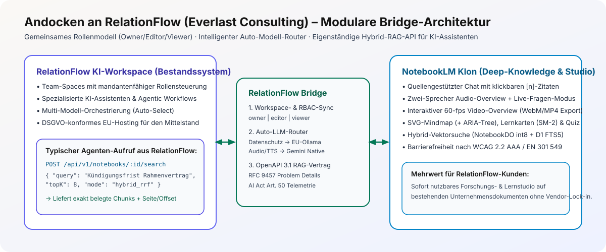
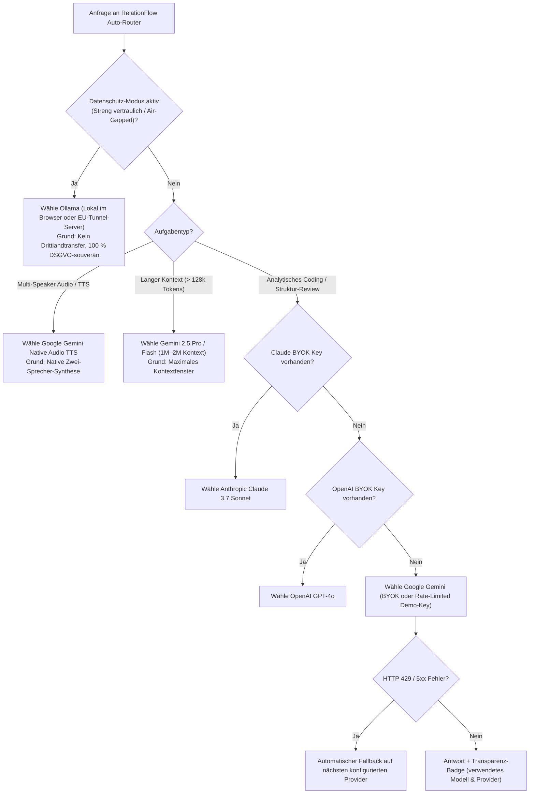

# Andocken an RelationFlow (Everlast Consulting GmbH)

Stand: 2026-11-09 · Referenzen: Entscheidungen #37, #40, #61, #63, #87, #88

<picture>
  <source media="(prefers-color-scheme: dark)" srcset="./assets/relationflow-bridge-dark.svg">
  <source media="(prefers-color-scheme: light)" srcset="./assets/relationflow-bridge-light.svg">
  
</picture>
<sub>Grafik in <a href="./assets/relationflow-bridge-de.svg" hreflang="de" lang="de">Deutsch</a> · <a href="./assets/relationflow-bridge-en.svg" hreflang="en" lang="en">English</a></sub>

## 1. Hintergrund & Strategische Passung

**RelationFlow** (`relationflow.io`) ist der DSGVO-konforme KI-Workspace der Everlast Consulting GmbH für den europäischen Mittelstand. Kernmerkmale von RelationFlow sind:
- Mandantenfähige **Team-Workspaces mit Rollensteuerung**,
- **Multi-Modell-Orchestrierung** (inklusive automatischer Modellwahl „Auto“ und EU-gehosteten Modellen),
- Spezialisierte **KI-Assistenten / Agents** sowie eine **Unternehmens-Wissensdatenbank mit Chat**.

Dieser NotebookLM-Klon wurde architektonisch so entworfen, dass er nicht nur als eigenständige Web-Applikation glänzt, sondern sich **ohne Umbau als tiefgehendes Quellenanalyse-, RAG- und Audio/Video-Studio-Modul direkt an RelationFlow andocken lässt**.

---

## 2. Die vier direkten Integrations-Schnittstellen

| RelationFlow-Konzept | Umsetzung im NotebookLM-Klon | Technische Schnittstelle |
|---|---|---|
| **1. Team-Spaces & Rollen (`RBAC`)** | Jedes Notebook gehört zu einem `workspace` mit den Rollen `owner`, `editor` und `viewer` sowie Echtzeit-Präsenz über `NotebookDO` WebSockets. | `/api/v1/workspaces`, Middleware `requireRole('viewer' \| 'editor' \| 'owner')`, Header-Workspace-Switcher im UI |
| **2. Multi-Modell-Router & „Auto“-Modus** | Einheitliches `LlmProvider`-Interface für **Gemini**, **OpenAI**, **Anthropic Claude** und **Ollama** (lokal & EU-Server via Cloudflare Tunnel). Der Modus **`auto`** wählt regelbasiert das optimale Modell und zeigt die Entscheidung transparent an. | `GET /api/v1/providers`, `AutoRouter` (`privacyMode -> ollama`, `task === 'tts' -> gemini`, Kontextgröße, Fallback-Kette bei `429`/`5xx`) |
| **3. Eigenständige Hybrid-RAG-API für RelationFlow-Agents** | Externe RelationFlow-Assistenten können das Notebook-Wissen direkt abfragen, ohne den Chat-UI-Umweg gehen zu müssen. | `POST /api/v1/notebooks/:id/search` liefert RRF-gerankte Chunks inkl. Score, `sourceId`, `page`, `startMs` und Zitat-Metadaten (OpenAPI 3.1 spezifiziert) |
| **4. Studio-Synthese als Agent-Tool** | RelationFlow-Workflows können aus einer Dokumentensammlung per API-Aufruf automatisch Briefings, FAQs, Mindmaps, Quizze oder Zwei-Sprecher-Audio-Briefings generieren lassen. | `POST /api/v1/notebooks/:id/artifacts` $\rightarrow$ asynchrone Verarbeitung via `JobDO` + Status-Webhook/WebSocket |

---

## 3. Entscheidungsbaum des RelationFlow „Auto“-Modell-Routers



---

## 4. Beispiel: Integration eines Notebooks als Tool in einem RelationFlow-Agenten

Ein RelationFlow-Agent kann über den standardisierten Endpunkt `POST /api/v1/notebooks/:id/search` verifizierte Fakten aus einem Notebook abrufen:

```http
POST /api/v1/notebooks/nb_relationflow_mittelstand/search HTTP/1.1
Host: notebook-lm-klon.workers.dev
Content-Type: application/json; charset=utf-8
Cookie: __Host-sid=...

{
  "query": "Welche Pflichten gelten nach Art. 50 EU AI Act für KI-generierte Audio-Zusammenfassungen?",
  "topK": 5,
  "mode": "hybrid"
}
```

**Antwort (`200 OK`, `application/json; charset=utf-8`):**
```json
{
  "notebookId": "nb_relationflow_mittelstand",
  "mode": "hybrid",
  "latencyMs": 4.2,
  "results": [
    {
      "citationIndex": 1,
      "chunkId": "chk_01J9RF001",
      "sourceId": "src_eu_ai_act_guide",
      "sourceTitle": "Leitfaden EU AI Act & DSGVO im Mittelstand.pdf",
      "page": 12,
      "score": 0.0328,
      "vectorRank": 1,
      "ftsRank": 1,
      "text": "Nach Art. 50 der KI-Verordnung (EU AI Act) müssen Anbieter und Betreiber sicherstellen, dass synthetische Audio-, Bild-, Video- oder Textinhalte sowohl für Menschen sichtbar als auch maschinenlesbar als künstlich erzeugt oder manipuliert gekennzeichnet werden."
    }
  ]
}
```

---

## 5. Eigener OpenAI-kompatibler Endpunkt (BYOM, Issue #247)

RelationFlow oder ein anderer Dienst mit OpenAI-kompatibler API lässt sich pro Nutzer als eigener Endpunkt
einbinden. Stand: Adapter, Einstellungen und Verbindungstest sind fertig und gegen einen lokalen
Fake-Server getestet. Ein Test gegen den echten RelationFlow-Endpunkt steht aus, weil die Schnittstelle
noch nicht dokumentiert ist (Anfrage-Entwurf: Issue #249).

| Teil | Datei |
|---|---|
| Adapter (`/chat/completions` mit und ohne Stream, `/embeddings`, `/models`) | `apps/worker/src/openai-compatible-provider.ts` |
| Schutz für Nutzer-Endpunkte | `apps/worker/src/endpoint-guard.ts` |
| Routen `GET/PUT/DELETE /api/v1/providers/custom`, `POST /api/v1/providers/custom/test` | `apps/worker/src/custom-endpoint-routes.ts` |
| Tabelle `provider_endpoints` (Adresse, Modelle; der Schlüssel liegt verschlüsselt in `provider_keys`) | `apps/worker/migrations/0003_custom_endpoints.sql` |
| Einstellung im UI (Deutsch und Englisch) | `apps/web/src/CustomEndpointSettings.tsx` |

**Betreiber-Konfiguration:** `BYOM_ALLOWED_HOSTS` als kommagetrennte Liste, z. B.
`api.relationflow.io,*.relationflow.io`. Ohne Eintrag ist die Funktion gesperrt.

**Regeln für jeden Aufruf:** nur `https:` auf Port 443, keine Zugangsdaten, Query-Parameter oder Fragmente
in der Adresse, Host auf der Allowlist, keine privaten oder reservierten Adressen, DNS-Prüfung aller A- und
AAAA-Einträge vor dem Aufruf (gegen DNS-Rebinding), keine Weiterleitungen, Zeitlimit 30 s. Der Schlüssel
geht nur im `Authorization`-Header raus und wird aus Fehlermeldungen entfernt.

**Im Chat nutzen:** `POST /api/v1/notebooks/:id/chat` mit `"model": "custom"`.

**Restrisiko:** Zwischen DNS-Prüfung und Verbindungsaufbau kann sich die Auflösung theoretisch ändern. Die
Allowlist begrenzt das auf Domains, denen der Betreiber vertraut.
