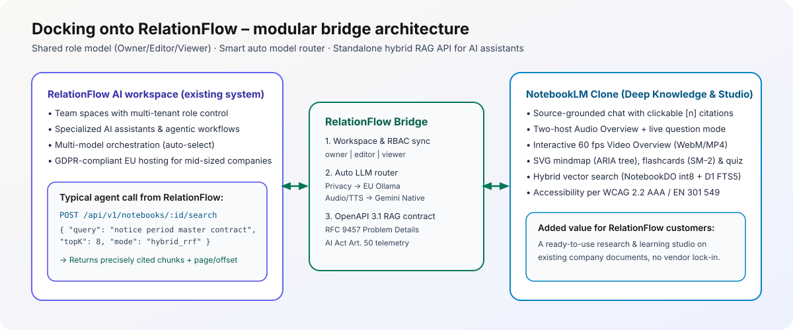
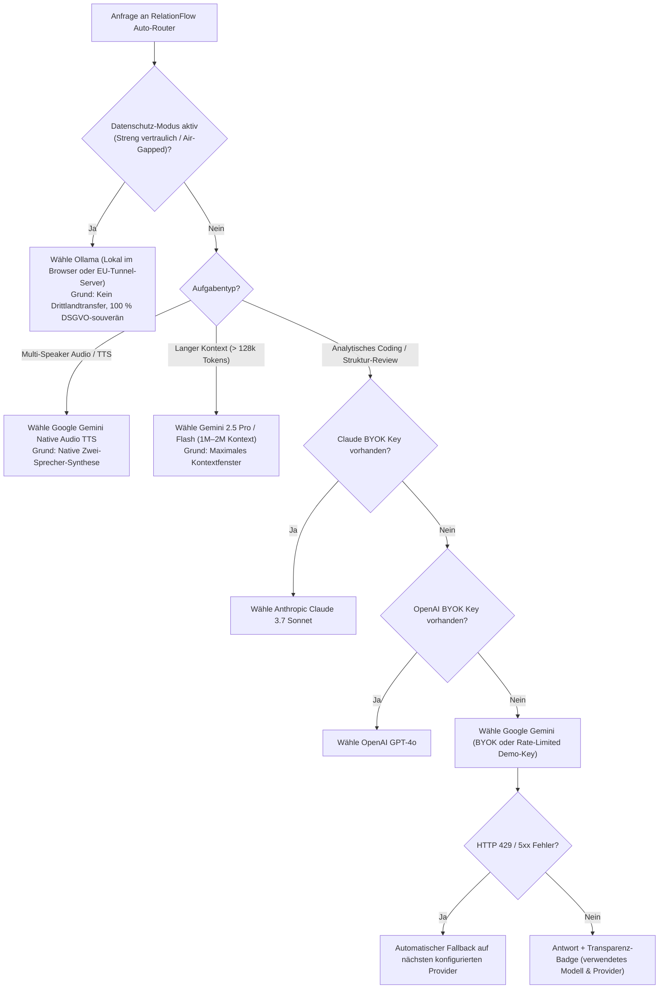

# Andocken an RelationFlow

Stand: 2026-11-09 · Referenzen: Entscheidungen #37, #40, #61, #63, #87, #88

<picture>
  <source media="(prefers-color-scheme: dark)" srcset="./assets/relationflow-bridge-dark.svg">
  <source media="(prefers-color-scheme: light)" srcset="./assets/relationflow-bridge-light.svg">
  
</picture>
<sub>Grafik in <a href="./assets/relationflow-bridge-de.svg" hreflang="de" lang="de">Deutsch</a> · <a href="./assets/relationflow-bridge-en.svg" hreflang="en" lang="en">English</a></sub>

## 1. Hintergrund & Strategische Passung

**RelationFlow** (`relationflow.io`) ist ein KI-Workspace für den europäischen Mittelstand. Nach den öffentlichen Angaben des Anbieters gehören dazu:
- Mandantenfähige **Team-Workspaces mit Rollensteuerung**,
- **Multi-Modell-Orchestrierung** (inklusive automatischer Modellwahl „Auto“ und EU-gehosteten Modellen),
- Spezialisierte **KI-Assistenten / Agents** sowie eine **Unternehmens-Wissensdatenbank mit Chat**.

Dieser NotebookLM-Klon ist so aufgebaut, dass er als eigenständige Web-Anwendung läuft und sich als Quellenanalyse-, RAG- und Studio-Modul an RelationFlow anbinden lässt. Ein Zugang zur RelationFlow-API lag nicht vor. Deshalb ist keine der Schnittstellen gegen RelationFlow selbst geprüft; die Anbindung ist generisch über die eigene Such-API und einen OpenAI-kompatiblen Weg geplant.

---

## 2. Die vier direkten Integrations-Schnittstellen

| RelationFlow-Konzept | Umsetzung im NotebookLM-Klon | Technische Schnittstelle |
|---|---|---|
| **1. Team-Spaces & Rollen (`RBAC`)** | Jedes Notebook gehört zu einem `workspace` mit den Rollen `owner`, `editor` und `viewer` sowie Echtzeit-Präsenz über `NotebookDO` WebSockets. | `/api/v1/workspaces`, Middleware `requireRole('viewer' \| 'editor' \| 'owner')`, Header-Workspace-Switcher im UI |
| **2. Multi-Modell-Router & „Auto“-Modus** | Einheitliches `LlmProvider`-Interface für **Gemini**, **OpenAI**, **Anthropic Claude** und **Ollama** (lokal & EU-Server via Cloudflare Tunnel). Der Modus **`auto`** wählt regelbasiert das optimale Modell und zeigt die Entscheidung transparent an. | `GET /api/v1/providers`, `AutoRouter` (`privacyMode -> ollama`, `task === 'tts' -> gemini`, Kontextgröße, Fallback-Kette bei `429`/`5xx`) |
| **3. Eigenständige Hybrid-RAG-API für RelationFlow-Agents** | Externe RelationFlow-Assistenten können das Notebook-Wissen direkt abfragen, ohne den Chat-UI-Umweg gehen zu müssen. | `POST /api/v1/notebooks/:id/search` liefert RRF-gerankte Chunks inkl. Score, `sourceId`, `page`, `startMs` und Zitat-Metadaten (OpenAPI 3.1 spezifiziert) |
| **4. Studio-Synthese als Agent-Tool** | RelationFlow-Workflows können aus einer Dokumentensammlung per API-Aufruf automatisch Briefings, FAQs, Mindmaps, Quizze oder Zwei-Sprecher-Audio-Briefings generieren lassen. | `POST /api/v1/notebooks/:id/artifacts` $\rightarrow$ asynchrone Verarbeitung via `JobDO` + Status-Webhook/WebSocket |

---

## 3. Entscheidungsbaum des RelationFlow „Auto“-Modell-Routers



---

## 4. Beispiel: Integration eines Notebooks als Tool in einem RelationFlow-Agenten

Ein RelationFlow-Agent kann über den standardisierten Endpunkt `POST /api/v1/notebooks/:id/search` verifizierte Fakten aus einem Notebook abrufen:

```http
POST /api/v1/notebooks/nb_relationflow_mittelstand/search HTTP/1.1
Host: notebook-lm-klon.workers.dev
Content-Type: application/json; charset=utf-8
Cookie: __Host-sid=...

{
  "query": "Welche Pflichten gelten nach Art. 50 EU AI Act für KI-generierte Audio-Zusammenfassungen?",
  "topK": 5,
  "mode": "hybrid"
}
```

**Antwort (`200 OK`, `application/json; charset=utf-8`):**
```json
{
  "notebookId": "nb_relationflow_mittelstand",
  "mode": "hybrid",
  "latencyMs": 4.2,
  "results": [
    {
      "citationIndex": 1,
      "chunkId": "chk_01J9RF001",
      "sourceId": "src_eu_ai_act_guide",
      "sourceTitle": "Leitfaden EU AI Act & DSGVO im Mittelstand.pdf",
      "page": 12,
      "score": 0.0328,
      "vectorRank": 1,
      "ftsRank": 1,
      "text": "Nach Art. 50 der KI-Verordnung (EU AI Act) müssen Anbieter und Betreiber sicherstellen, dass synthetische Audio-, Bild-, Video- oder Textinhalte sowohl für Menschen sichtbar als auch maschinenlesbar als künstlich erzeugt oder manipuliert gekennzeichnet werden."
    }
  ]
}
```

---

## 5. Eigener OpenAI-kompatibler Endpunkt (BYOM, Issue #247)

RelationFlow oder ein anderer Dienst mit OpenAI-kompatibler API lässt sich pro Nutzer als eigener Endpunkt
einbinden. Stand: Adapter, Einstellungen und Verbindungstest sind fertig und gegen einen lokalen
Fake-Server getestet. Ein Test gegen den echten RelationFlow-Endpunkt steht aus, weil die Schnittstelle
noch nicht dokumentiert ist (Anfrage-Entwurf: Issue #249).

| Teil | Datei |
|---|---|
| Adapter (`/chat/completions` mit und ohne Stream, `/embeddings`, `/models`) | `apps/worker/src/providers/openai-compatible-provider.ts` |
| Schutz für Nutzer-Endpunkte | `apps/worker/src/security/endpoint-guard.ts` |
| Routen `GET/PUT/DELETE /api/v1/providers/custom`, `POST /api/v1/providers/custom/test` | `apps/worker/src/routes/custom-endpoint-routes.ts` |
| Tabelle `provider_endpoints` (Adresse, Modelle; der Schlüssel liegt verschlüsselt in `provider_keys`) | `apps/worker/migrations/0006_custom_endpoints.sql` |
| Einstellung im UI (Deutsch und Englisch) | `apps/web/src/CustomEndpointSettings.tsx` |

**Erlaubte Hosts:** Jeder öffentliche HTTPS-Endpunkt ist erlaubt (Entscheidung F247). Interne,
private und lokale Ziele bleiben gesperrt (Liste unten). Optional kann der Betreiber mit
`BYOM_ALLOWED_HOSTS` zusätzlich einschränken, als kommagetrennte Liste, z. B.
`api.example.com,*.example.com`. Nicht gesetzt oder leer heißt: keine zusätzliche Einschränkung.
Die Basis-URL endet auf den Versionspfad, z. B. `https://api.example.com/v1`; der Adapter hängt
`/chat/completions`, `/embeddings` und `/models` an.

**Regeln für jeden Aufruf** (`apps/worker/src/security/endpoint-guard.ts`):

- nur `https:` auf Port 443, keine Zugangsdaten, Query-Parameter oder Fragmente in der Adresse;
- gesperrte IP-Literale in jeder Schreibweise (dezimal, oktal, hex, gekürzt; IPv4-mapped, NAT64,
  6to4, Teredo werden auf die eingebettete IPv4 geprüft): `0.0.0.0/8`, `10/8`, `100.64/10` (CGNAT),
  `127/8`, `169.254/16` (Link-local, Metadaten wie `169.254.169.254`), `172.16/12`, `192.0.0/24`,
  `192.0.2/24`, `192.88.99/24`, `192.168/16`, `198.18/15`, `198.51.100/24`, `203.0.113/24`,
  `224/4` (Multicast), `240/4` inkl. Broadcast; IPv6 `::`, `::1`, `64:ff9b:1::/48`, `100::/64`,
  `2001::/23` (u. a. Teredo, Benchmarking, ORCHID), `2001:db8::/32`, `3fff::/20`, `5f00::/16`,
  `fc00::/7` (ULA, z. B. `fd00:ec2::254`), `fe80::/10`, `fec0::/10`, `ff00::/8`;
- gesperrte Namen: `localhost`, `*.localhost`, `*.local`, `*.localdomain`, `*.internal`
  (z. B. `metadata.google.internal`), `*.arpa` (auch `*.home.arpa`) und Namen ohne Punkt
  (z. B. `intranet`), jeweils auch mit abschließendem Punkt;
- DNS-Prüfung aller A- und AAAA-Einträge über DNS-over-HTTPS beim Speichern und unmittelbar vor
  jedem Aufruf; ein einziger nicht öffentlicher Eintrag oder eine fehlgeschlagene Auflösung sperrt;
- keine Weiterleitungen (`redirect: "manual"`, jede 3xx-Antwort ist ein Fehler);
- Zeitlimits: 30 s je Aufruf ohne Stream, Header und Body zusammen (auch der Verbindungstest); im
  Stream Abbruch nach 60 s ohne neue Daten und spätestens nach 10 min Gesamtdauer;
- Größenlimits: höchstens 16 MiB je Antwort bzw. je Stream; Fehlerantworten werden nur bis 4 KiB
  gelesen und auf 200 Zeichen gekürzt;
- Verbindungstest (`POST /api/v1/providers/custom/test`): eigenes Limit von 5 Tests pro Minute und
  Nutzer, zusätzlich zur allgemeinen Ratenbegrenzung;
- der Schlüssel geht nur im `Authorization`-Header raus und wird aus Fehlermeldungen entfernt;
- der Schlüssel ist per Associated Data (AES-GCM) an den Origin des Endpunkts gebunden: Er lässt
  sich nur für Schema, Host und Port entschlüsseln, für die er gespeichert wurde. Ändert sich der
  Origin der Adresse, wird er gelöscht (`keyCleared: true`) und muss neu eingegeben werden. Ohne
  gespeicherten Endpunkt nimmt `PUT /api/v1/keys/custom` keinen Schlüssel an (409).

**Im Chat nutzen:** `POST /api/v1/notebooks/:id/chat` mit `"model": "custom"`. Fehlt der Endpunkt, antwortet
der Server sofort mit 503 (`CUSTOM_ENDPOINT_UNAVAILABLE`), ohne Chat oder Nachricht anzulegen. Die
Modellauswahl in der Oberfläche bietet „Eigener Endpunkt" noch nicht an; der Chat nutzt ihn bisher nur
über die API.

**Restrisiko DNS-Rebinding:** Möglich ist auf Cloudflare Workers nur, die Auflösung unmittelbar vor
jedem Aufruf zu prüfen. Nicht möglich ist, die Verbindung an die geprüfte IP zu binden: `fetch` löst
den Namen selbst noch einmal auf, ein eigener Resolver oder eine feste Ziel-IP mit passendem
TLS-Namen lässt sich nicht vorgeben. Ein Angreifer mit eigener Domain und sehr kurzer TTL kann deshalb
zwischen Prüfung und Verbindungsaufbau die Antwort wechseln (TOCTOU). Auf Workers laufen ausgehende
Anfragen über das Cloudflare-Netz; private Netze des Betreibers sind von dort nicht erreichbar, das
begrenzt den Schaden. Beim Betrieb als Node-Server (`apps/worker/src/node-server.ts`) gibt es diesen
Netzabstand nicht. Dort laufen Aufrufe eigener Endpunkte deshalb über `apps/worker/src/platform/node/pinned-fetch.ts`:
Der Name wird beim Verbindungsaufbau aufgelöst, jede gelieferte Adresse geprüft, und der Socket nutzt genau
diese Adressen. Liefert der Name auch nur eine private, lokale oder reservierte Adresse, wird nicht
verbunden. Ein Wechsel der DNS-Antwort zwischen Prüfung und Verbindung bringt damit nichts. Wer interne
Dienste im selben Netz hat, kann zusätzlich `BYOM_ALLOWED_HOSTS` setzen oder ausgehenden Verkehr per
Firewall auf das Internet beschränken.
