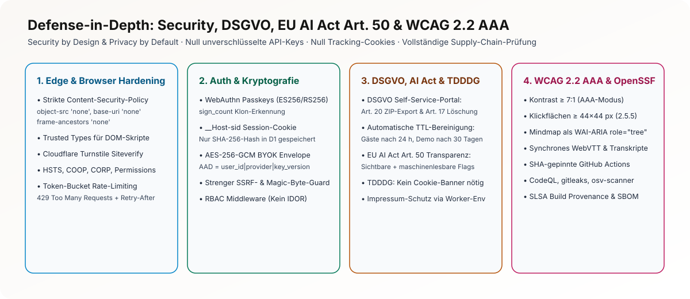

# Sicherheit, Datenschutz (DSGVO), EU AI Act Art. 50 & Barrierefreiheit (WCAG 2.2 AAA)

Stand: 2026-11-09 · Referenzen: Entscheidungen #5, #6, #8, #31, #32, #33, #49, #59, #71

> **Rechtlicher Hinweis:** Die juristischen und regulatorischen Ausarbeitungen in diesem Projekt stellen eine sorgfältige technische Vorprüfung nach bestem Engineering-Standard dar, ersetzen jedoch im Produktivbetrieb keine Rechtsberatung durch eine Kanzlei.

<picture>
  <source media="(prefers-color-scheme: dark)" srcset="./assets/security-layers-dark.svg">
  <source media="(prefers-color-scheme: light)" srcset="./assets/security-layers-light.svg">
  
</picture>
<sub>Grafik in <a href="./assets/security-layers-de.svg" hreflang="de" lang="de">Deutsch</a> · <a href="./assets/security-layers-en.svg" hreflang="en" lang="en">English</a></sub>

## 1. Kryptografisches Konzept: BYOK Envelope Encryption (`AES-256-GCM`)

Nutzer können eigene API-Schlüssel für Google Gemini, OpenAI und Anthropic Claude hinterlegen (*Bring Your Own Key*). Diese Schlüssel werden **niemals im Klartext gespeichert** und **niemals an den Browser zurückgegeben**:

1. **Master Key (`KEK_V1`):** Liegt ausschließlich als geschütztes Cloudflare Worker Secret vor.
2. **Envelope-Verschlüsselung pro Schlüssel:** Bei jedem `PUT /api/v1/keys/:provider` generiert der Worker einen kryptografisch sicheren 96-Bit-Initialisierungsvektor (`iv = crypto.getRandomValues(new Uint8Array(12))`).
3. **Additional Authenticated Data (`AAD`):** Um zu verhindern, dass ein verschlüsselter Datenbankeintrag (`ciphertext`) in D1 einem anderen Nutzer oder einem anderen Provider untergeschoben werden kann (*Ciphertext Transplanting*), wird der Kontext fest in das GCM-Authentifizierungs-Tag eingebunden:
   $$\text{AAD} = \text{UTF8}(\texttt{user\_id} \mathbin{\Vert} \texttt{"|"} \mathbin{\Vert} \texttt{provider} \mathbin{\Vert} \texttt{"|v"} \mathbin{\Vert} \texttt{key\_version})$$
4. **Maskierte Anzeige:** Die Datenbank speichert lediglich `ciphertext`, `iv`, `key_version` und die letzten 4 Zeichen (`last4`). Das Frontend sieht ausschließlich `••••1a2b`.

### 1.1 Pflicht-Secrets (kein Ersatzwert im Code)

Der Worker enthält für keines dieser Secrets einen eingebauten Standardwert. Fehlt eines, schaltet er die betroffene Funktion ab, statt mit einem unsicheren Ersatz weiterzulaufen.

| Secret | Wofür | Fehlt oder ungültig |
|---|---|---|
| `KEK_V1` (optional `KEK_V2` … `KEK_V10` und `KEK_CURRENT_VERSION`; älterer Name `BYOK_MASTER_KEY`) | Master Key für die BYOK-Verschlüsselung | `/api/v1/keys*` antwortet mit `503 BYOK_NOT_CONFIGURED` und speichert nichts. Ein KEK unter 32 Zeichen gilt als ungültig. |
| `SESSION_SALT_SECRET` | Salt für die Hashes von IP und User-Agent in Sitzungen | Anmeldung antwortet mit `503 SESSION_SALT_NOT_CONFIGURED` |
| `TURNSTILE_SECRET_KEY` | Bot-Schutz für Gastzugang und Magic-Link | `503 TURNSTILE_NOT_CONFIGURED` |

**KEK erzeugen:** 32 Zufallsbytes, als Hex (64 Zeichen) oder Base64 (44 Zeichen):

```sh
openssl rand -hex 32        # oder: openssl rand -base64 32
```

**KEK setzen:**

- Cloudflare: `pnpm --filter @notebook-lm/worker exec wrangler secret put KEK_V1`, dann den Wert einfügen. Für `wrangler dev` gehört er in `apps/worker/.dev.vars`; die Datei ist per `.gitignore` ausgeschlossen.
- Node/Docker: als Umgebungsvariable `KEK_V1` des Prozesses. `docker-compose.yml` reicht `KEK_V1`, `KEK_V2` und `KEK_CURRENT_VERSION` aus der Umgebung des Hosts durch. Vorlage: `apps/worker/.env.example` (nach `.env` im Projektordner kopieren und füllen, `docker compose` liest sie dort).

Den KEK nie ins Repository, in Tickets oder in Logs schreiben. Geht er verloren, lassen sich gespeicherte BYOK-Schlüssel nicht mehr entschlüsseln, und die Nutzer müssen sie neu eingeben.

**KEK rotieren:**

1. Neuen Schlüssel als `KEK_V2` setzen und `KEK_V1` stehen lassen.
2. `KEK_CURRENT_VERSION=2` setzen. Neue und geänderte BYOK-Schlüssel werden ab jetzt mit Version 2 verschlüsselt, alte bleiben mit Version 1 lesbar.
3. Bestehende Einträge umschlüsseln: `POST /api/v1/keys/rekey` stellt die Einträge der angemeldeten Person auf die aktuelle Version um.
4. `KEK_V1` erst entfernen, wenn `SELECT COUNT(*) FROM provider_keys WHERE key_version = 1;` in D1 `0` ergibt.

---

## 2. Authentifizierung, Session-Sicherheit & Bot-Schutz

- **WebAuthn Passkeys (`@simplewebauthn`):** Phishing-resistente Anmeldung ohne Passwörter. Erfüllt gleichzeitig die Barrierefreiheitsanforderung **WCAG 2.2 Kriterium 3.3.8 / 3.3.9 (Accessible Authentication)**, da keine kognitiven Rätsel, Transkriptionen oder Passwort-Merkleistungen verlangt werden. Der Signaturzähler (`sign_count`) wird bei jedem Login geprüft, um geklonte Authentifikatoren zu erkennen.
- **Gehärtetes Session-Cookie (`__Host-sid`):**
  - Attribute: `Secure; HttpOnly; SameSite=Lax; Path=/` (das Präfix `__Host-` erzwingt HTTPS und verbietet Subdomain-Manipulation).
  - In der D1-Tabelle `sessions` wird **nur der `SHA-256`-Hash** des Session-Tokens gespeichert. Selbst ein vollständiger Datenbank-Dump erlaubt keine Session-Übernahme.
- **CSRF- & SSRF-Schutz:**
  - Schreibende Anfragen (`POST`, `PUT`, `PATCH`, `DELETE`) prüfen `Origin` und `Sec-Fetch-Site`.
  - Der URL-Importer blockiert strikt nicht-öffentliche IP-Bereiche (`127.0.0.0/8`, `10.0.0.0/8`, `172.16.0.0/12`, `192.168.0.0/16`, `169.254.169.254` Cloud-Metadaten, `::1`, `fc00::/7`), unsichere Schemata (`file:`, `javascript:`, `data:`) und begrenzt Redirects sowie Antwortgrößen.

---

## 3. EU-Rechtskonformität: DSGVO, TDDDG, DDG & EU AI Act Art. 50

| Rechtsrahmen | Technische Umsetzung im Projekt |
|---|---|
| **DSGVO (Art. 5, 15, 17, 20, 25, 32)** | • **Privacy by Default:** Lokaler Ollama-Modus (`127.0.0.1:11434`) überträgt keinerlei Daten an Dritte.<br>• **Datenminimierung:** IP-Adressen für Rate-Limits und Audit-Logs werden ausschließlich als tagesrotierter `SHA-256`-Hash gespeichert.<br>• **Speicherbegrenzung (Cron-TTL):** Gastkonten werden nach 24 h, Demo-Notebooks nach 30 Tagen inklusive aller R2-Objekte automatisch gelöscht.<br>• **Betroffenenrechte per 1-Klick:** Asynchroner Datenexport (`GET /api/v1/me/export` als ZIP via `JobDO`), sofortige Kontolöschung (`DELETE /api/v1/me`) und persönliches Sicherheits-Audit-Log (`GET /api/v1/me/audit`). |
| **TDDDG (ehem. TTDSG § 25)** | • **Kein Cookie-Banner erforderlich:** Es wird ausschließlich ein technisch zwingend notwendiges Session-Cookie (`__Host-sid`) nach expliziter Nutzeranmeldung gesetzt. Optionale Offline-Caches (`IndexedDB`) werden nur auf Wunsch des Nutzers aktiviert. |
| **DDG § 5 (Impressum & Adressschutz)** | • Vollständiges Impressum mit zwei unmittelbaren Kontaktwegen (E-Mail + Turnstile-geschütztes Kontaktformular `/api/v1/contact`).<br>• **Schutz privater Adressdaten im öffentlichen Repo (Entscheidung #59):** Im Quellcode stehen Platzhalter; die reale Wohnadresse wird erst zur Laufzeit über Cloudflare-Worker-Umgebungsvariablen in `/api/v1/legal/imprint` injiziert. |
| **EU AI Act (Art. 50 Transparenzpflichten)** | • **Sichtbare Kennzeichnung:** Jede KI-Antwort, Zusammenfassung und jedes Audio-/Video-Artefakt trägt einen klaren Hinweis auf das erzeugende Modell.<br>• **Synthetische Stimmen (Deepfake-/Audio-Transparenz):** Der Zwei-Sprecher-Audio-Overview weist synthetische KI-Stimmen explizit im Player und im Transkript aus.<br>• **Maschinenlesbare Provenienz:** Alle API-Antworten und Export-Artefakte enthalten strukturierte `ai_generated: true`-Metadaten, Modellkennung und Zeitstempel.<br>• **Missbrauchsmeldung:** Integrierter Endpunkt `POST /api/v1/abuse-reports` für fehlerhafte oder unangemessene KI-Ausgaben. |

---

## 4. Barrierefreiheit nach WCAG 2.2 AA/AAA & EN 301 549 (BFSG)

1. **Visuelle Skalierbarkeit & 3 Farbmodi je Design:** Jedes der 4 Design-Systeme bietet **Light**, **OLED Dark** und einen dedizierten **AAA-Hochkontrast-Modus** (Kontrastverhältnis $\ge 7:1$, verstärkte Fokusringe $\ge 3\text{ px}$).
2. **Motorische Zugänglichkeit (WCAG 2.5.5 AAA & 2.5.7):** Alle interaktiven Bedienelemente besitzen eine Mindestzielgröße von **$44 \times 44\text{ px}$**. Für jede Drag-and-Drop-Aktion (Datei-Upload, Mindmap-Navigation) existiert ein vollwertiges Tastatur- und Button-Äquivalent.
3. **Screenreader- & Multimodale Äquivalente:**
   - **Mindmap:** Neben der interaktiven SVG-Grafik steht eine vollständig per Pfeiltasten navigierbare **WAI-ARIA-Baumansicht (`role="tree"`, `role="treeitem"`)** bereit.
   - **Audio- & Video-Overview:** Synchronisierte **WebVTT-Untertitel (`.vtt`)**, interaktives Volltext-Transkript mit Sprungmarken sowie eine **Audiodeskriptions-Spur** für sämtliche visuellen Folieninhalte.
   - **Chat-Streaming:** Gedrosselte `aria-live="polite"`-Ansagen (satzweise statt tokenweise, damit Screenreader nicht stottern) + 1-Klick-Vorlesefunktion.
   - **Leichte Sprache (DIN SPEC 33429):** Eigener Erklärmodus für komplexe Fachtexte.
