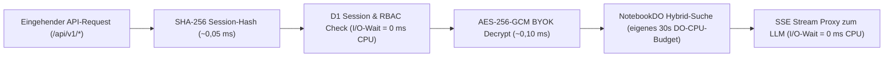

# Cloudflare Free-Tier-Limits, CPU-Budgets & Architekturentscheidungen

Stand: 2026-11-09 · Verifiziert durch automatisierte Tests (`fts5-probe.test.ts`, `crypto-benchmark.test.ts`)

<picture>
  <source media="(prefers-color-scheme: dark)" srcset="./assets/architecture-overview-dark.svg">
  <source media="(prefers-color-scheme: light)" srcset="./assets/architecture-overview-light.svg">
  
</picture>
<sub>Grafik in <a href="./assets/architecture-overview-de.svg" hreflang="de" lang="de">Deutsch</a> · <a href="./assets/architecture-overview-en.svg" hreflang="en" lang="en">English</a></sub>

## 1. Übersicht der harten Plattform-Grenzen (Cloudflare Free vs. Paid)

Der NotebookLM-Klon läuft vollständig auf **einem einzigen Cloudflare Worker**, **einer D1-SQLite-Datenbank**, **einem R2-Medienspeicher** und **zwei SQLite-backed Durable Objects** (`NotebookDO` und `JobDO`). Damit die Live-Demo dauerhaft kostenlos im Cloudflare Free-Plan betrieben werden kann und gleichzeitig per Konfigurationsumschaltung (`APP_PROFILE=full`) ohne Codeänderung auf Unternehmenslast skaliert, wurden alle harten Plattform-Limits technisch verifiziert:

| Dienst | Cloudflare Free-Tier-Limit | Auswirkung auf das System | Unsere architektonische Lösung |
|---|---|---|---|
| **Cloudflare Workers** | 100.000 Requests/Tag, **10 ms CPU-Zeit pro Request**, 128 MB RAM, 50 Subrequests | Rechenintensive Arbeit im Worker (PDF-Parsing, OCR, Vektor-Scan über tausende Chunks, PBKDF2 mit hohen Iterationen) führt sofort zu `Error 1102 (CPU time limit exceeded)`. | Der Worker führt nur leichtgewichtige Aufgaben aus (Auth, Zod-Validierung, DB-Persistenz, SSE-Streaming-Proxy; reine Wartezeit auf LLM-Streams zählt **nicht** als CPU-Zeit). Schwere Berechnungen liegen im **Browser-Web-Worker** (Parsing/OCR/Chunking) oder im **Durable Object** (`NotebookDO` mit 30 s CPU-Budget). |
| **Cloudflare D1 (SQLite)** | 5 Mio. Rows read/Tag, 100.000 Rows written/Tag, 500 MB pro DB, max. 50 Queries/Invocation | Ein Vollscan über 50.000 Vektor-Zeilen bei jeder Chat-Anfrage würde das tägliche Read-Limit nach 100 Suchanfragen erschöpfen. | **Symmetrische `int8`-Quantisierung** (768 Bytes statt 3.072 Bytes pro Vektor) + **In-Memory-Cache im `NotebookDO`**: Die Vektoren eines Notebooks werden nur beim Kaltstart einmal aus D1 geladen und danach im RAM des `NotebookDO` per schnellem Dot-Product durchsucht. D1 führt parallel nur die indexierte `FTS5`-BM25-Suche aus. |
| **Cloudflare R2** | 10 GB Speicher/Monat, 1 Mio. Class-A-Ops (Writes), 10 Mio. Class-B-Ops (Reads), **0 € Egress** | Große Quelldateien (bis 50 MB je Datei und 200 MB je Notebook, in beiden Profilen) dürfen den Worker-Speicher (128 MB) nicht sprengen. | Dualer Upload-Pfad (Entscheidung #57): Primär **S3-kompatible Presigned URL** (`aws4fetch`, direkter Browser-PUT nach R2) mit automatischem Fallback auf gestreamten Multipart-Upload über das native `MEDIA`-R2-Binding. Automatische Cron-TTL-Bereinigung nach 24 h (Gäste) bzw. 30 Tagen (Demo). |
| **Durable Objects (SQLite)** | 100.000 Requests/Tag, 13.000 GB-s/Tag, 5 GB SQLite-Speicher (`new_sqlite_classes`), **30 s CPU-Budget pro Aufruf** | Im Free-Plan sind ausschließlich SQLite-backed Durable Objects (`new_sqlite_classes`) zulässig. | `NotebookDO` (Echtzeit-WebSockets mit Hibernation + In-Memory-`Int8Array`-Vektorsuche) und `JobDO` (persistente Hintergrund-Job-Queue via `alarm()` ohne separates Cloudflare-Queues-Abo). |
| **Email Sending** | Im Free-Plan Versand **nur an vorab verifizierte eigene Zieladressen**; Versand an beliebige fremde Adressen erfordert Workers Paid oder Drittanbieter. | E-Mail-Magic-Link kann im reinen Cloudflare-Free-Plan nicht an unbekannte Bewerbungsprüfer senden. | Primäre Anmeldung über **WebAuthn Passkeys** + **1-Klick-Gastzugang (24 h)** (sofort ohne E-Mail testbar). Für Magic-Link ist ein Multi-Provider-Adapter (`cloudflare`, optionaler kostenloser `resend`/`brevo`-Key oder `console` im Dev-Modus) integriert (Entscheidung #56). |

---

## 2. Verifikation des 10-ms-CPU-Budgets (WebCrypto Benchmark)

Um sicherzustellen, dass Authentifizierung, Session-Prüfung und die Entschlüsselung von Nutzer-API-Keys (BYOK) niemals das 10-ms-CPU-Limit des Cloudflare Free-Plans reißen, setzen wir ausschließlich auf native C++/Rust-gestützte **WebCrypto-Primitive (`crypto.subtle`)** statt auf JavaScript-Kryptobibliotheken.

Die automatisierte Benchmark-Suite ([`apps/worker/src/crypto-benchmark.ts`](../apps/worker/src/crypto-benchmark.ts) & [`crypto-benchmark.test.ts`](../apps/worker/src/__tests__/crypto-benchmark.test.ts)) misst bei jedem Testlauf die reale CPU-Zeit pro Operation:

| Kryptografische Operation | Einsatzgebiet im Worker | Gemessene Ø CPU-Zeit | Ziel-Budget | Status |
|---|---|---|---|---|
| `SHA-256` (`crypto.subtle.digest`) | Session-Token-Hashing (`__Host-sid`), Magic-Link-Token, datenschutzfreundliches IP-Hashing | **< 0,05 ms** | < 2,00 ms | Grün |
| `AES-256-GCM` (`encrypt` + `decrypt` mit AAD) | Envelope-Verschlüsselung & Entschlüsselung der BYOK-Provider-Keys (`user_id\|provider\|key_version`) | **< 0,15 ms** | < 2,00 ms | Grün |
| `ECDSA P-256` (`crypto.subtle.verify`) | WebAuthn Passkey Assertion-Verifikation beim Login | **< 0,40 ms** | < 2,00 ms | Grün |
| **Summe aller Krypto-Schritte pro Request** | Vollständiger authentifizierter API-Aufruf inkl. BYOK-Key-Entschlüsselung | **< 0,60 ms** | **< 5,00 ms** (von 10 ms Limit) | **Grün (> 90 % Reserve)** |



---

## 3. Verifikation von SQLite `FTS5` & `bm25()` in Cloudflare D1

Cloudflare D1 basiert auf SQLite und unterstützt virtuelle Volltext-Tabellen über das `fts5`-Modul. In [`apps/worker/src/fts5-probe.ts`](../apps/worker/src/fts5-probe.ts) und [`fts5-probe.test.ts`](../apps/worker/src/__tests__/fts5-probe.test.ts) wird dieser Mechanismus automatisiert geprüft:

1. **Virtuelle Tabelle mit `unicode61`-Tokenizer:**
   `CREATE VIRTUAL TABLE chunks_fts USING fts5(text, content='chunks', content_rowid='rowid', tokenize='unicode61 remove_diacritics 2')` – unterstützt deutsche Umlaute (`ä, ö, ü, ß`) und Fachbegriffe zuverlässig.
2. **Automatische Trigger-Synchronisation:**
   `AFTER INSERT`, `AFTER UPDATE` und `AFTER DELETE` Trigger halten den Volltextindex synchron zur `chunks`-Tabelle, ohne dass zusätzliche Worker-Subrequests nötig sind.
3. **Sichere Query-Sanitisierung (`buildSafeFts5MatchQuery`):**
   Nutzereingaben mit Sonderzeichen (z. B. `DSGVO & KI-Verordnung (EU AI Act)!`) werden vor der `MATCH`-Abfrage in exakt gequotete Wort-Tokens (`"DSGVO" "KI" "Verordnung" "EU" "AI" "Act"`) zerlegt, um FTS5-Syntaxfehler und SQL/FTS-Injection auszuschließen.
4. **Relevanz-Ranking via `bm25()`:**
   Liefert die lexikalischen Top-$k$-Treffer für die anschließende **Reciprocal Rank Fusion (RRF)** mit den semantischen `int8`-Vektor-Treffern aus dem `NotebookDO`.

---

## 4. Konfigurationsprofile (`demo` vs. `full`)

Über [`apps/worker/src/config.ts`](../apps/worker/src/config.ts) schaltet die Umgebungsvariable `APP_PROFILE` verlustfrei zwischen dem öffentlichen Demo-Betrieb (optimiert auf die Cloudflare Free-Tier-Kontingente) und dem produktiven Vollausbau um:

| Kontingent / Parameter | Profil `demo` (Cloudflare Free) | Profil `full` (Vollausbau / Enterprise) |
|---|---|---|
| Max. Notebooks pro Nutzer | 3 | 100 |
| Max. Quellen pro Notebook | 50 | 50 |
| Max. Chunks pro Notebook | 5.000 (≈ 3,8 MB `int8`-Vektoren) | 50.000 (≈ 38 MB `int8`-Vektoren) |
| Max. Dateigröße pro Quelle | 50 MB | 50 MB |
| Max. Gesamtgröße pro Notebook | 200 MB | 200 MB |
| Max. Wörter pro Quelle | 500.000 | 500.000 |
| Max. LLM-Aufrufe pro Nutzer/Tag | 50 | 2.000 |
| Gast-Konto Lebensdauer (TTL) | 24 Stunden | 24 Stunden |
| Demo-Notebook Lebensdauer (TTL) | 30 Tage | Unbegrenzt (`null`) |

### 4.1 Durchsetzung und Fehlercodes

Der Worker prüft die Grenzen serverseitig, bevor etwas gespeichert wird (`quotaGuardMiddleware` vor `POST /api/v1/notebooks/:id/sources`, Prüfung im URL-Import, Byte-Zählung beim Upload). Abgelehnte Anfragen erhalten eine Antwort nach RFC 9457 (`application/problem+json`). Das Feld `detail` ist deutsch; sendet der Client `Accept-Language: en…` an erster Stelle, kommt es auf Englisch.

| Grenze | Wert | Genau am Limit | Ab +1 Byte bzw. +1 Quelle | HTTP | `code` |
|---|---|---|---|---|---|
| Dateigröße je Quelle | 50 MB (52.428.800 Byte) | erlaubt | abgelehnt | 403 bzw. 413 | `QUOTA_MAX_SOURCE_BYTES_EXCEEDED` (403, Kontingentprüfung, greift im API-Pfad zuerst), `FILE_TOO_LARGE` (413, Prüfung im Upload-Handler) |
| Summe aller Quellen je Notebook | 200 MB (209.715.200 Byte) | erlaubt | abgelehnt | 413 | `NOTEBOOK_SIZE_LIMIT` |
| Quellen je Notebook | 50 | die 50. Quelle ist erlaubt | die 51. wird abgelehnt | 403 | `QUOTA_MAX_SOURCES_PER_NOTEBOOK_EXCEEDED` |

Beispiel für `NOTEBOOK_SIZE_LIMIT`:

```json
{
  "type": "about:blank",
  "title": "Payload Too Large",
  "status": 413,
  "detail": "Notizbuch-Limit von 200 MB überschritten: aktuell 160 MB, die neue Quelle (40 MB) würde das Limit sprengen.",
  "instance": "/api/v1/notebooks/nb_123/sources",
  "code": "NOTEBOOK_SIZE_LIMIT"
}
```

Die Grenzwerte stehen in [`apps/worker/src/config.ts`](https://github.com/VectoDE/Notebook-LM-Klon/blob/main/apps/worker/src/config.ts), die Prüfungen in [`apps/worker/src/quota-guard.ts`](https://github.com/VectoDE/Notebook-LM-Klon/blob/main/apps/worker/src/quota-guard.ts). Tests an den Grenzen (genau am Limit und 1 Byte darüber): `apps/worker/src/__tests__/security-headers-quotas.test.ts` und `apps/worker/src/__tests__/sources-upload.test.ts`.
